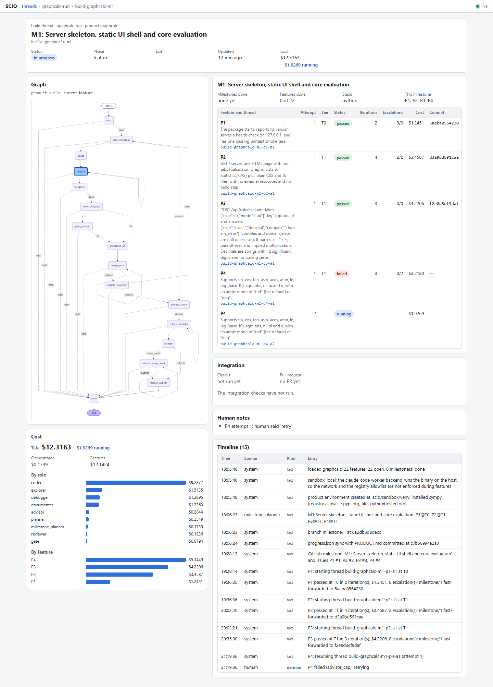

# SCIO

A model-agnostic, multi-agent framework built on LangGraph that turns a prompt into product-ready software. Today it takes one software task, from a spec or a GitHub Issue, to a merged, tested and documented pull request, reliably and live. Product Mode (M6 to M11) extends that to whole products, from a prompt or a `PRODUCT.md`, in Python or TypeScript, one approved milestone at a time, through a release gate to a tagged release.

> Status: **v0.8.0 released; Product Mode M6 to M11 and the post-M11 follow-ups done.** The product eval suite passes live on one commit: a CLI todo app (p001), a REST API (p002) and a web app graded in a real browser (p003), each built from a fixed `PRODUCT.md` to a released v0.1.0 whose hidden black-box tests pass ($11.63 estimated for all three, nothing billed). `scio new` and `scio build` have also bootstrapped and built live products on the Claude Code backend: `todo_tags` (M8), `bookmarks_api` (M9: a Python HTTP service with a third-party dependency, black-box acceptance against the started server, $5.38 estimated, nothing billed) and `notes_service` (M10: a TypeScript HTTP service with zod, eslint, tsc, npm audit and black-box acceptance all green, $4.61 estimated, nothing billed). Post-M11 follow-ups ([issue #58](https://github.com/NewMe505/SCIO/issues/58), [PR #59](https://github.com/NewMe505/SCIO/pull/59), [ADR 0016](docs/adr/0016-post-m11-follow-ups.md)) are done and released in 0.8.0: squash-safe `--gh` merges and a release PR, `scio upgrade` (live: `bookmarks_api` upgraded and its M2 built, $4.56 estimated), Node in the Docker sandbox, `run_app` in a container, parallel CI tests. Merged since: Always/Never guardrails enforced by a docs check and a push-gate hook (#61), and `scio dashboard`, a live read-only web view of every thread's step, pending stop and cost across workspaces (#70, [ADR 0017](docs/adr/0017-dashboard.md)). In progress: a live product test, `graphcalc` (a TI-Nspire-style graphing calculator built by v0.8.0), and the fixes it finds (#64, merged: the quality bar follows the stack, hand edits of PRODUCT.md survive, `scio new` threads report, spend spans invocations; #66, merged: GitHub labels are created before use; [issue #69](https://github.com/NewMe505/SCIO/issues/69): the worker's `python` is the product's environment, `skip` defers a feature). Task mode is proven live: ten regression tasks at pass^5 = 1.00 offline, nightly live suites green. Roadmap: [docs/PRODUCT_MODE.md](docs/PRODUCT_MODE.md); decision records: [docs/adr/](docs/adr/); board: [SCIO Product Mode](https://github.com/users/NewMe505/projects/1); milestones: [M6 to M11](https://github.com/NewMe505/SCIO/milestones).

## Product Mode in one paragraph
A product orchestrator sits above the proven task graph. It interviews you (two to four Opus questions), writes a normalised `PRODUCT.md`, picks a toolchain profile, and bootstraps a repository with CI and a walking skeleton. Then, milestone by milestone, it decomposes work into GitHub issues, runs each feature through the task graph with the tier pinned, verifies the integrated result against a fixed quality bar (tests with a coverage floor, lint, types, build, smoke and e2e against the running app, dependency audit, secret scan, working README instructions), and opens one milestone PR for a human to merge. Any failing check overrides any model verdict. There is one writer, so a product builds serially; there is no product-level dollar cap by default, but per-feature tier caps, stall caps and iteration caps remain as runaway guards, and cost is reported at every approval stop.

| Milestone | Deliverable | Done when |
|---|---|---|
| [M6 Foundations](https://github.com/NewMe505/SCIO/milestone/1) (done, [ADR 0009](docs/adr/0009-toolchain-profiles.md)) | Toolchain profiles behind one protocol; `--tier` pins the route; declared settings read | regression pass^5 = 1.00, live t001 unchanged, no Python command outside the profile |
| [M7 Greenfield bootstrap](https://github.com/NewMe505/SCIO/milestone/2) (done, [ADR 0010](docs/adr/0010-product-graph-and-bootstrap.md)) | `scio new`: interview, `PRODUCT.md`, scaffold, git init, CI, walking skeleton | an empty directory becomes a repo with green CI and a smoke test, Fake and live |
| [M8 Decompose + milestone loop](https://github.com/NewMe505/SCIO/milestone/3) (done, [ADR 0011](docs/adr/0011-milestone-loop.md)) | progress file, GitHub milestones and issues, features in sequence, integration verify, milestone PR, resume | a two-milestone Fake product survives crash and resume; one live milestone (`todo_tags`) |
| [M9 Dependencies + runtime](https://github.com/NewMe505/SCIO/milestone/4) (done, [ADR 0013](docs/adr/0013-product-runtime.md)) | product environment and install phase, `install_deps` / `run_app` / `delete_file`, quality bar, acceptance against the started app, Docker default with an egress-proxy allowlist | a product with a third-party dependency and an HTTP server passes black-box e2e: Fake `todo_api` and live `bookmarks_api` |
| [M10 Second stack](https://github.com/NewMe505/SCIO/milestone/5) (done, [ADR 0014](docs/adr/0014-second-stack-node-ts.md), [PR #52](https://github.com/NewMe505/SCIO/pull/52)) | `node-ts` profile, stack detection, stack-neutral acceptance | the same spec builds in Python and TypeScript: `todo_api` on the Fake in both stacks; live `notes_service` (TypeScript, zod) M1 merged |
| [M11 Product-ready + evals](https://github.com/NewMe505/SCIO/milestone/6) (done, [ADR 0015](docs/adr/0015-product-ready-release-and-product-evals.md), [PR #56](https://github.com/NewMe505/SCIO/pull/56)) | honest coverage floor checked in every feature, secret scan, release files, README run check, Dockerfiles, release gate (tag, artifact, GitHub Release); `scio new --spec`; p001 CLI, p002 REST API, p003 web app | p001 to p003 pass live on one commit, graded by hidden black-box tests (p003 in a real browser): $11.63 estimated, nothing billed; rows in [EVAL_HISTORY](docs/EVAL_HISTORY.md) |

## Task mode in one paragraph
A cheap router classifies each task into an effort tier (T0, T1 or T2). **Opus 5.5** plans, advises and checks that the objective was met before finishing. **Sonnet 5** does the work: coding, testing, debugging and documentation. Only one agent writes code. Parallel fan-out is used only for read-only exploration and review. Tests, linters and type checks decide pass/fail, not LLM opinion. Sonnet escalates to Opus only on specific signals (repeated errors, stalls, low confidence, plan drift, high-impact changes), with a cap on how often. Every run produces a GitHub PR, and the docs are updated in that same PR.

## Five layers
| Layer | Responsibility |
|---|---|
| Prompt | Versioned role templates with typed (Pydantic) outputs |
| Context | Just-in-time retrieval, compaction, artifacts passed by reference |
| Harness | Provider adapters, retries, budgets, caching, tracing, sandbox |
| Loop | Bounded act → verify → fix loops with explicit exit conditions |
| Graph | Checkpointed LangGraph StateGraph and routing |

## Usage

Requires Python 3.12 and [uv](https://docs.astral.sh/uv/).

```bash
uv sync --all-extras --group dev          # install (add --native-tls behind a corporate proxy)
uv run pytest                              # offline, Fake provider
uv run python scripts/check_docs.py        # docs checks (links, model-ID leak, changelog)
uv run python -m evals.runner --suite regression --provider fake --trials 5
uv run python scripts/gen_api_docs.py      # API docs → docs/api/ (pdoc)
```

Run a task against a repository (the router picks T0, T1 or T2). The spec is Markdown: first heading = title, checkbox
lines = acceptance criteria. The run pauses for a human before merge; resume with a decision.

```bash
uv run scio run --spec task.md --repo https://github.com/you/repo --issue 12
uv run scio resume --thread run-ab12cd34 --decision "approved"
SCIO_PROVIDER_OVERRIDE=fake uv run scio run --spec evals/tasks/t001_add_function/spec.md --repo <path>   # offline
```

Set `SCIO_GH_REPO=owner/name` to push the branch and open the draft PR; without it the run is
offline and the PR body is written to `.scio/artifacts/<thread>/pr-body.txt`.
`SCIO_FAKE_SCRIPT=1` with the Fake provider drives the scripted eval behaviour from the CLI.

Product mode (M7, ADR 0010): a prompt becomes a bootstrapped repository. The run stops twice for
you, after the interview questions and on the `PRODUCT.md` draft; a third stop asks before a
GitHub repository is created when `--gh` is given. A prompt starts a thread, no prompt resumes one.

```bash
uv run scio new --prompt "A CLI todo app with tags and JSON export" --dir ./todo [--gh you/todo]
uv run scio new --thread new-ab12cd34 --dir ./todo --decision "1: developers; 2: add and list; 3: no sync"
uv run scio new --thread new-ab12cd34 --dir ./todo --decision approve      # or revision notes
uv run scio new --spec PRODUCT.md --dir ./todo     # M11: bootstrap your own PRODUCT.md as written
```

The result is a git repository on `main` with `PRODUCT.md`, `NOTES.md`, `.scio/product/progress.json`,
a package that answers `--version`, smoke tests that drive the app in-process, CI that runs the
profile's lint and tests and the README's run commands, README, CHANGELOG, LICENSE, a Dockerfile and
`.gitignore`; lint and tests ran green before the bootstrap commit.

The milestone loop (M8, ADR 0011) then builds the product one approved milestone at a time. Every
feature in `PRODUCT.md` starts `todo`, the walking skeleton included; the orchestrator always takes the
first open feature, an Opus planner groups up to four into a milestone with a tier each, GitHub gets a
milestone and one issue per feature (or `.scio/product/issues/` offline), and each feature runs through
the task graph on its own checkpoint thread on branch `milestone/<n>`. After the last feature the
profile's full suite and lint run on the branch, an Opus milestone gate gives a verdict that any failing
check overrides, and one milestone PR waits for you. A crash at any point resumes without a duplicated
issue, commit or PR; a feature that halts stops for one decision (`retry`, `skip`, or stop).
`skip` defers the feature to the next milestone; the release waits until every feature in `PRODUCT.md`
is done, so a feature leaves the product only when you remove it from `PRODUCT.md`.
Every feature's verify also holds it to the product's coverage floor (`SCIO_COVERAGE_FLOOR`, 80% of
the product's own code by default). When no milestone remains, the release gate (M11) runs the whole
bar on `main` (coverage, secret scan, release files, the README's run commands, black-box acceptance)
and stops for you once more; `release` cuts the changelog, tags `v<version>` and keeps a source archive
under `.scio/sandbox/release/`. With `--gh` the cut goes through a release PR that you merge (SCIO
never pushes `main`), then the merge commit is tagged and a GitHub Release carries the archive.

```bash
uv run scio build --product ./todo [--gh you/todo]        # runs the next milestone, pauses at its PR
uv run scio build --product ./todo --decision merged      # after you merged the PR (offline: "merge")
uv run scio build --product ./todo --decision release     # at the release gate (or "stop")
uv run scio build --product ./todo --decision "merge and stop"   # record the milestone, end the thread
uv run scio build --product ./todo --decision skip        # defer it; or retry / stop, when a feature halted
uv run scio status --product ./todo                       # progress.json as text
uv run scio report --thread build-todo_cli                # feature runs, cost, escalations
uv run scio upgrade --product ./todo                      # bring an older product to today's bar
```

`scio upgrade` (issue #58) adds what a product bootstrapped by an older SCIO lacks, generated from the
current scaffold for its own `PRODUCT.md`: the Dockerfile and `.dockerignore`, the README's run block,
the coverage source for a python product, and the CI's README run step. Files the product made its own
are kept and reported; the change is one commit, a clean tree is required, and a second run does nothing.
In GitHub mode a squash- or rebase-merged milestone PR is fine: SCIO drops only its own bookkeeping
commits when it syncs `main`, and stops with `sync_failed` if a commit of yours exists only locally.

To watch builds live (ADR 0017), install the `dashboard` extra and point `scio dashboard` at the
directories SCIO ran in. It serves http://127.0.0.1:8765 only and never writes: every thread's
current step on its graph, the stop waiting for you, feature runs with tier, iterations and cost,
the timeline and cost by role and by feature, refreshed over a WebSocket as checkpoints land. It is
safe to run beside a live build. [docs/OBSERVABILITY.md](docs/OBSERVABILITY.md) covers it with the
other two views: GitHub (`--gh`) and an OpenTelemetry trace viewer for model calls.

```bash
UV_SYSTEM_CERTS=1 uv sync --all-extras    # a bare `--extra dashboard` would remove the other extras
uv run python -m scio dashboard --root . --root ../graphcalc-run   # one --root per workspace
```



Running on a Claude subscription instead of the API (ADR 0012): with `SCIO_PROVIDER_OVERRIDE=claude_code`
every tool-less role (router, planners, advisor, gates, reviewer) runs as one `claude -p` call, and with
`SCIO_WORKER_BACKEND=claude_code` every tool-using turn (coder, debugger, documenter, explorer) is one
Claude Code session in the sandbox root followed by a typed summary on `--resume`. The binary is the
unmodified Claude Code signed in with your own account (`claude` on PATH, or `SCIO_CLAUDE_CODE_BIN`);
nothing is billed to a Console organisation, the dollars in reports are the API-price estimate Claude
Code prints. Verify, commits, the gate and the PR flow are unchanged; local sandbox only.

```bash
SCIO_PROVIDER_OVERRIDE=claude_code SCIO_WORKER_BACKEND=claude_code uv run scio run --spec task.md --repo ./repo
```

After a run, `uv run scio report --thread <id>` writes `.scio/reports/<id>.md` and `.json`:
tokens and dollars by role, every escalation with its outcome, and the ledger timeline.

Product evals (M11, ADR 0015): `python -m evals.runner --suite product [--task p001_cli_todo]` builds
each task's fixed `PRODUCT.md` through `scio new --spec` and `scio build` to a release, then runs
hidden black-box tests against the released product (p003 in a real browser: run
`python -m playwright install chromium` once).

Evals: `python -m evals.runner --suite regression|capability --provider fake --config evals/configs/<ab>.yaml`
runs a suite under an A/B role configuration (`sonnet_only`, `sonnet_opus_advisor`, `opus_only`);
`--parallel N` runs a task's trials concurrently; `--max-usd X` stops starting tasks once the suite's
spend reaches X (the report says what was skipped). `python -m evals.tune` sweeps the escalation
thresholds (ADR 0006).

Nightly live suite: `python scripts/nightly_live.py` runs regression and capability on Anthropic
under a total cost cap (default $10), using the `ant auth login` profile, and appends one row per
suite to [docs/EVAL_HISTORY.md](docs/EVAL_HISTORY.md). On the dev machine it is registered as the
Windows scheduled task `SCIO nightly live evals` (03:17 daily); remove it with
`schtasks /delete /tn "SCIO nightly live evals" /f`. The GitHub nightly workflow runs the same
capped commands and switches to the live provider only when an `ANTHROPIC_API_KEY` or
`ANTHROPIC_AUTH_TOKEN` repository secret exists. The nightly workflow runs
both suites per config and posts the tables to the job summary.

## Acceptance status (PROMPT.md)

| Criterion | Status | Evidence |
|---|---|---|
| Crash mid-run resumes from checkpoint with zero duplicated side effects | met | `tests/durability/test_crash_resume.py`, `tests/graph/test_t0_fake.py::test_resume_after_crash_does_not_duplicate_commits` |
| Provider swap is config-only; full suite passes on the Fake provider offline | met | `configs/models.yaml`, CI runs with `SCIO_PROVIDER_OVERRIDE=fake` |
| Sample task passes with pass^5 ≥ 0.8 within a stated budget | met, live | t001 on Anthropic (Sonnet 5 worker, Opus 5.5 gate, Haiku router): 5/5 trials, one iteration each, ≈55k tokens and $0.13 per trial against a 150k / $1.50 cap (2026-10-11); Fake-provider regression pass^5 = 1.00 as well |
| Advisor calls ≤ cap, each logged with trigger, cost and outcome | met | `EscalationRecord`; `tests/unit/test_escalation.py`, `tests/graph/test_t1_t2_fake.py` |
| Sample task produces a GitHub PR linked to its issue, template filled, docs in the same PR, CI green | met | Recorded 2026-10-10 on the throwaway repository `NewMe505/scio-eval-sandbox` (issue #1 → PR #2, Fake provider, template filled, docs in the PR, that repo's CI green); the repository was deleted afterwards. Ledger I-028 and the M5 retrospective describe the run |

Calling a model through the harness. Roles, models, effort and prices live only in
`configs/models.yaml`; code never names a model.

```python
from pydantic import BaseModel
from scio.harness import Harness, Message
from scio.prompt import PromptRegistry


class Verdict(BaseModel):
    verdict: str
    guidance: str


harness = Harness.from_settings(tier="T1")  # budget guard from configs/budgets.yaml
system = PromptRegistry().get("advisor").render()  # static, cacheable system prompt
request = harness.build_request("advisor", system=system, messages=[Message.user("...brief...")])
result = harness.structured(request, Verdict)  # validate locally, repair ≤2 times
print(result.value, result.attempts, harness.summary())
```

Credentials: either `ANTHROPIC_API_KEY`, or a Claude login profile created with `ant auth login`
(the SDK picks it up automatically). A set `ANTHROPIC_API_KEY` always wins over the profile, so unset
a stale one. Install the CLI from https://github.com/anthropics/anthropic-cli/releases.

Environment (`SCIO_*`, see `scio/settings.py`): `SCIO_PROVIDER_OVERRIDE=fake` routes every
role to the offline Fake provider (CI does this); `SCIO_OTEL_EXPORTER=console|otlp` turns on
tracing (`otlp` reads `OTEL_EXPORTER_OTLP_ENDPOINT`, install the `otlp` extra);
`SCIO_OTEL_CAPTURE_CONTENT=1` opts in to recording prompt text on spans. Provider credentials
are read by the SDKs (`ANTHROPIC_API_KEY`, `OPENAI_API_KEY`). Live tests:
`SCIO_RUN_LIVE_TESTS=1 uv run pytest tests/live -m live`.

M2 settings: `SCIO_CHECKPOINT_DSN` (`memory://`, `sqlite:///.scio/checkpoints.sqlite`, `postgresql://...`),
`SCIO_EFFECTS_PATH` (idempotent side-effect log), `SCIO_SANDBOX_BACKEND=local|docker|e2b` with
`SCIO_SANDBOX_DOCKER_IMAGE` / `SCIO_SANDBOX_E2B_TEMPLATE` and the `postgres` / `e2b` extras, and
`SCIO_GH_REPO=owner/name` for the GitHub client. Regenerate graph diagrams with
`uv run python scripts/gen_mermaid.py` (the docs check fails when they drift).

## Docs
- [docs/ARCHITECTURE.md](docs/ARCHITECTURE.md): Milestone 0 design (graphs, State, agent contracts, directory tree, milestone plan)
- [docs/PROMPT.md](docs/PROMPT.md): the build spec / generation prompt
- [docs/RESEARCH.md](docs/RESEARCH.md): the evidence behind each design decision
- [docs/PRODUCT_MODE.md](docs/PRODUCT_MODE.md): roadmap M6–M11, from single tasks to building product-ready software from a prompt in any stack
- [docs/IDEAS_TRIAGE.md](docs/IDEAS_TRIAGE.md): ROI triage of proposed improvements against live data
- [docs/OBSERVABILITY.md](docs/OBSERVABILITY.md): how to watch SCIO: GitHub, an OpenTelemetry trace viewer, `scio dashboard`, the CLI views
- [docs/adr/](docs/adr/): Architecture Decision Records (0001 topology and models, 0002 harness conventions, 0003 idempotent effects and sandbox tiers, 0004 loop and verification, 0005 escalation policy, 0006 thresholds from data, 0007 product mode, 0008 advisor review of high-impact diffs, 0009 toolchain profiles, 0010 product graph and bootstrap, 0011 milestone loop, 0012 Claude Code backend, 0013 product runtime, 0014 second stack: node-ts and profile detection, 0015 product-ready: quality bar, release gate, product evals, 0016 post-M11 follow-ups: GitHub-mode merges and releases, upgrade, sandbox image per stack, run_app in a container, 0017 a live read-only dashboard)
- [CONTRIBUTING.md](CONTRIBUTING.md): branching, commits, PRs, docs-as-code
- [CHANGELOG.md](CHANGELOG.md)

## Roadmap
Task mode (complete, released as 0.1.0 to 0.4.0):
- M0 (done): architecture, State schema, agent contracts, directory tree
- M1 (done): harness, providers (Anthropic, OpenAI, Fake), prompt layer, eval skeleton, CI
- M2 (done): state, checkpointing with idempotent effects, ACI tools, sandbox backends, GitHubClient
- M3 (done): router, context and loop layers, the T0 graph end to end, graph-driven evals
- M4 (done): T1/T2 tiers, parallel explorers, planner, six-signal triage, capped Opus advisor, reviewer
- M5 (done): nightly capability suite, A/B configs, threshold tuning (ADR 0006), run reports, release workflow
- post-0.1.0 (done): live validation, realistic and path-specific eval tasks t006 to t010, advisor review of passing high-impact diffs (ADR 0008)

Product Mode ([docs/PRODUCT_MODE.md](docs/PRODUCT_MODE.md), ADR 0007; tracked on the [project board](https://github.com/users/NewMe505/projects/1)):
- M6 (done, 0.4.0): toolchain profiles (ADR 0009), `--tier` pins the route, every declared setting read
- M7 (done, 0.5.0): `scio new`, greenfield bootstrap from a prompt to a repository with green CI (ADR 0010)
- M8 (done, 0.6.0): progress file, GitHub milestones and issues, the milestone loop with crash-safe resume (ADR 0011); the Claude Code backend runs SCIO on a subscription (ADR 0012)
- M9 (done, 0.6.0): product environment and install phase, `install_deps` / `run_app` / `delete_file`, quality bar, acceptance against the started app, Docker by default with an egress-proxy allowlist (ADR 0013)
- M10 (done, 0.6.0): `node-ts` profile, stack detection, a stack-neutral product path (ADR 0014); live TypeScript milestone `notes_service`
- M11 (done, 0.7.0): product-ready quality bar, release gate, product eval suite p001 to p003 passing live (ADR 0015)
- post-M11 (done, 0.8.0): squash-safe `--gh` merges, a release PR, `scio upgrade`, Node in the Docker sandbox, `run_app` in a container, parallel CI tests (ADR 0016)
- dashboard (in progress, issue #68): `scio dashboard`, a live read-only view of every thread across workspaces (ADR 0017)
