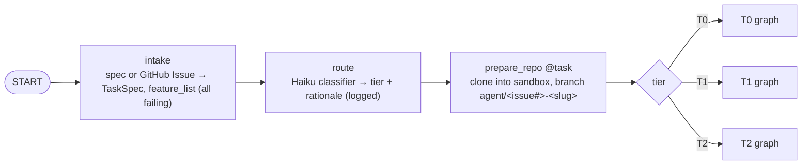
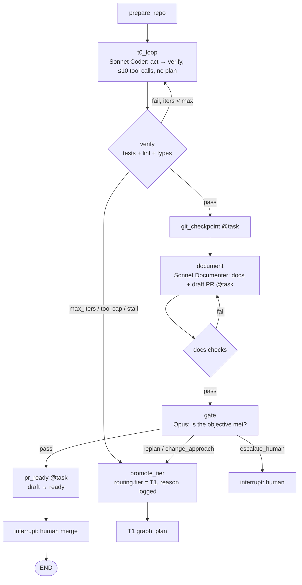
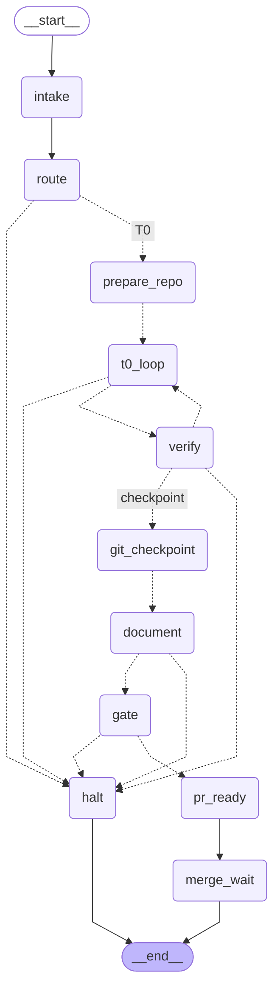
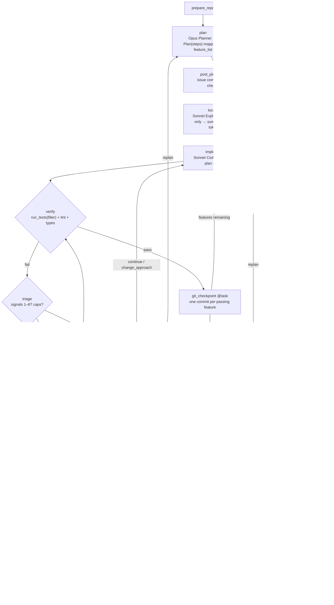
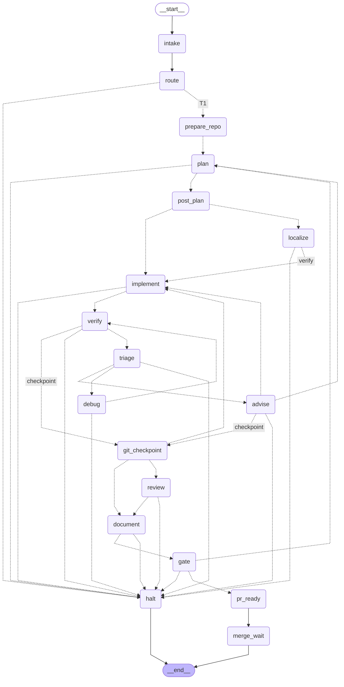
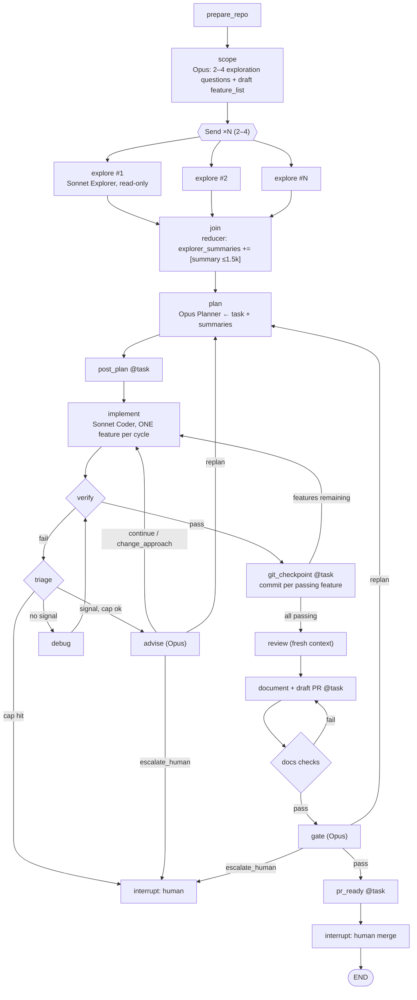
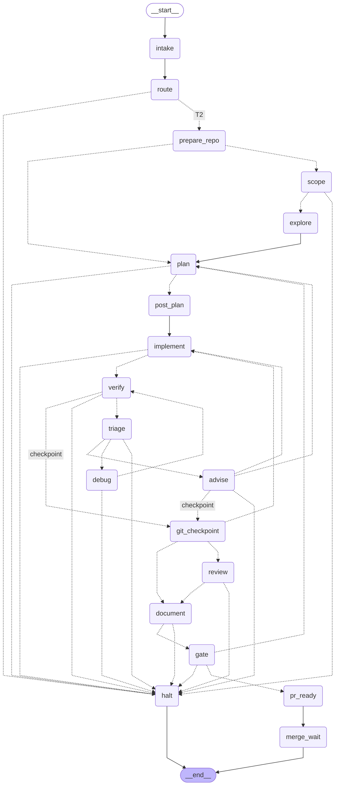
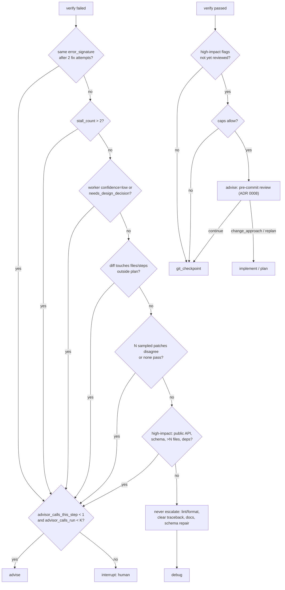
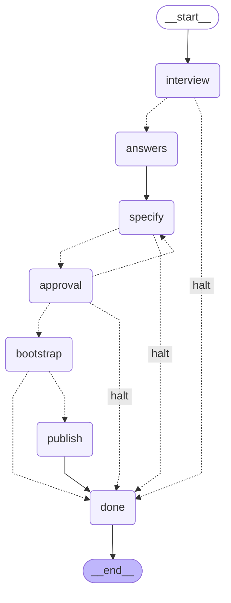
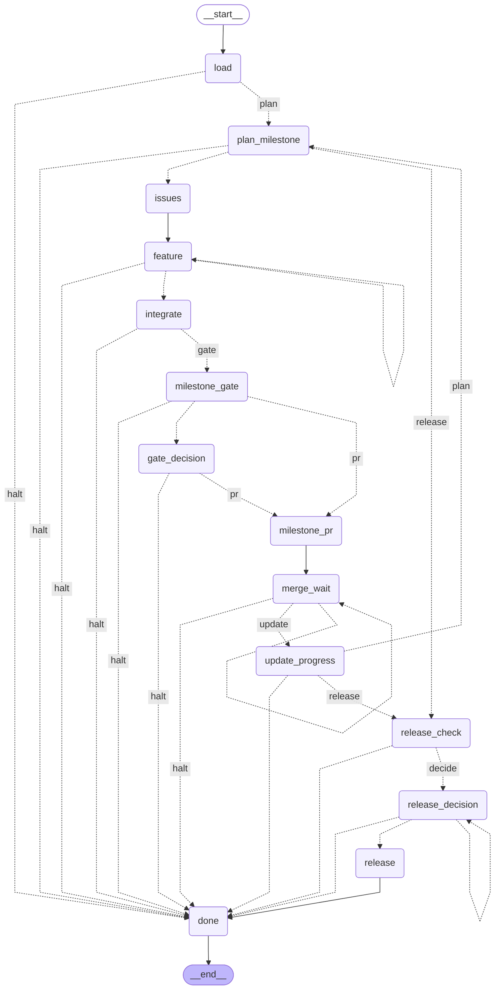

# SCIO architecture (Milestone 0)

Status: **All milestones (M0 to M5) implemented; release 0.1.0.** All five layers exist, all three tiers run end to end through one graph (`scio run`), the capped escalation policy is live and tuned from a recorded sweep, and the first real GitHub run produced an issue-linked PR with green CI. This document is the output of the build prompt in [PROMPT.md](PROMPT.md), section "How to respond". Sections: (a) graphs per tier, (b) State, (c) agent contracts, (d) directory tree, (e) milestone plan, (f) assumptions and open questions.

From M2 on, the Mermaid diagrams in section (a) are regenerated from the compiled graph by `scripts/gen_mermaid.py`, and CI fails if this file and the compiled graph disagree.

---

## (a) Graphs per tier

Conventions used in every diagram:

- Rounded boxes are LangGraph nodes. `@task` marks a node whose side effects run inside an idempotent task keyed by `hash(thread_id, node, intent)`.
- Diamonds are conditional edges (pure functions of state, no model call).
- `interrupt` nodes stop the run for a human; nothing side-effecting runs before the interrupt inside that node.
- Opus 5.5 nodes: `scope`, `plan`, `advise`, `gate`. Everything else is Sonnet 5, except `route` and `compact` (Haiku).
- Exit conditions are checked by the Loop layer on every iteration: `success | max_iters | budget | stall | escalate_human`.

### Shared prefix (all tiers)



### T0: trivial

One Sonnet loop, at most 10 tool calls, no planner. Failure never calls the Advisor. It re-routes to T1, which is cheaper than consulting Opus on a task that was mis-tiered.



#### T0 as compiled (generated; do not edit by hand)

The section below is produced by `scripts/gen_mermaid.py` from `scio.graph.tiers.t0` and checked in CI. The sketch above is the M0 design; the compiled graph is the truth.

<!-- scio:graph:t0:begin -->

<!-- scio:graph:t0:end -->

### T1: standard

Opus plans, Sonnet implements and verifies one feature at a time, Opus gates. The `triage` edge evaluates the six escalation signals against state; it is a pure function and never calls a model.



#### T1 as compiled (generated; do not edit by hand)

<!-- scio:graph:t1:begin -->

<!-- scio:graph:t1:end -->

### T2: large or ambiguous

Same backbone as T1 with two changes: a short Opus `scope` call produces 2–4 exploration questions, and those run as parallel read-only Explorers (LangGraph `Send`) whose summaries reduce into state before planning. Still exactly one writer.



#### T2 as compiled (generated; do not edit by hand)

<!-- scio:graph:t2:begin -->

<!-- scio:graph:t2:end -->

### Escalation triage (conditional edge, all tiers except T0)



A passing verify escalates on one signal only: an unreviewed high-impact diff gets a pre-commit advisor review (ADR 0008). `continue` commits without another coder turn; a refused review commits as usual.

---

## (b) State as Pydantic code

Design rules baked into the schema:

- Everything large is an `ArtifactRef` (path + sha256), never inline text.
- Lists that parallel branches append to carry an `operator.add` reducer. Fan-out nodes may return only those keys.
- Every worker output cites `step_id`. The triage edge compares `files_touched` to the plan step's `files_expected` (signal 4).
- `error_signature` is a normalized hash of exception type + top frame + first assertion line. It is what "same error after 2 attempts" compares.

```python
"""scio/state/models.py — SCIO graph state (M0 draft)."""

from __future__ import annotations

import operator
from datetime import datetime
from enum import Enum
from typing import Annotated, Literal

from pydantic import BaseModel, Field


# ---------- enums ----------


class Tier(str, Enum):
    T0 = "T0"
    T1 = "T1"
    T2 = "T2"


class FeatureStatus(str, Enum):
    FAILING = "failing"
    PASSING = "passing"
    SKIPPED = "skipped"  # only by human decision, recorded in task_ledger


class Role(str, Enum):
    ROUTER = "router"
    PLANNER = "planner"
    SCOPER = "scoper"
    EXPLORER = "explorer"
    CODER = "coder"
    TESTER = "tester"
    DEBUGGER = "debugger"
    REVIEWER = "reviewer"
    DOCUMENTER = "documenter"
    ADVISOR = "advisor"
    GATE = "gate"
    COMPACTOR = "compactor"
    HUMAN = "human"
    SYSTEM = "system"


class Verdict(str, Enum):
    CONTINUE = "continue"
    REPLAN = "replan"
    CHANGE_APPROACH = "change_approach"
    ESCALATE_HUMAN = "escalate_human"


class ExitReason(str, Enum):
    SUCCESS = "success"
    MAX_ITERS = "max_iters"
    BUDGET = "budget"
    STALL = "stall"
    ESCALATE_HUMAN = "escalate_human"
    ADVISOR_CAP = "advisor_cap"


class EscalationTrigger(str, Enum):
    FIXED_PLAN = "fixed_plan"  # touchpoint (a)
    FIXED_GATE = "fixed_gate"  # touchpoint (b)
    REPEATED_ERROR = "repeated_error"  # 1
    STALL = "stall"  # 2
    LOW_CONFIDENCE = "low_confidence"  # 3
    PLAN_DRIFT = "plan_drift"  # 4
    SAMPLE_DISAGREEMENT = "sample_disagreement"  # 5
    HIGH_IMPACT = "high_impact"  # 6


Phase = Literal[
    "intake",
    "route",
    "prepare",
    "scope",
    "explore",
    "plan",
    "post_plan",
    "localize",
    "implement",
    "verify",
    "debug",
    "advise",
    "checkpoint",
    "review",
    "document",
    "gate",
    "pr_ready",
    "merge_wait",
    "done",
    "halted",
]


# ---------- references and ledgers ----------


class ArtifactRef(BaseModel):
    """Pass-by-reference handle. Never put file contents in state."""

    kind: Literal[
        "diff", "test_output", "lint_output", "summary", "brief", "log", "plan_comment", "pr_body"
    ]
    path: str  # absolute path inside the sandbox or artifact store
    sha256: str
    tokens: int | None = None  # measured with the provider's count_tokens
    produced_by: Role
    created_at: datetime


class TaskSpec(BaseModel):
    title: str
    description: str
    acceptance: list[str]  # one line each; becomes feature_list
    repo_url: str
    base_branch: str = "main"
    issue_number: int | None = None
    tier_hint: Tier | None = None  # from the issue template dropdown
    constraints: list[str] = Field(default_factory=list)
    non_goals: list[str] = Field(default_factory=list)


class FeatureItem(BaseModel):
    id: str  # "F1", "F2", ...
    description: str
    test_filter: str | None = None  # pytest -k / path passed to run_tests
    status: FeatureStatus = FeatureStatus.FAILING
    commit_sha: str | None = None  # set by git_checkpoint when it passes
    evidence: ArtifactRef | None = None


class PlanStep(BaseModel):
    id: str  # "S1", "S2", ...
    description: str
    feature_ids: list[str]
    files_expected: list[str]  # used by plan-drift detection (signal 4)
    done: bool = False


class Plan(BaseModel):
    version: int = 1
    author: Role  # PLANNER, or ADVISOR after a replan
    steps: list[PlanStep]
    rationale: str
    revision_reason: str | None = None


class LedgerEntry(BaseModel):
    kind: Literal["fact", "guess", "decision"]
    text: str
    source: Role
    step_id: str | None = None
    at: datetime


class ProgressLedger(BaseModel):
    current_step_id: str | None = None
    current_feature_id: str | None = None
    attempts_on_step: int = 0
    fix_attempts_on_error: int = 0
    last_error_signature: str | None = None
    stall_count: int = 0  # +1 each iteration with no change to this ledger's fingerprint
    iterations: int = 0
    tool_calls: int = 0  # T0 cap = 10
    last_fingerprint: str | None = None


class Budget(BaseModel):
    tokens_max: int
    tokens_used: int = 0
    usd_max: float
    usd_used: float = 0.0
    advisor_calls_max: int  # K per run
    advisor_calls_used: int = 0
    advisor_calls_on_step: dict[str, int] = Field(default_factory=dict)  # ≤1 per step
    max_iters: int = 30
    max_stall: int = 2

    @property
    def exhausted(self) -> bool:
        return self.tokens_used >= self.tokens_max or self.usd_used >= self.usd_max


class Routing(BaseModel):
    tier: Tier
    pattern: Literal["single_loop", "plan_execute_gate", "explore_plan_execute_gate"]
    effort_tier: Literal["low", "medium", "high", "xhigh"]
    rationale: str
    classifier_model: str
    confidence: float
    promoted_from: Tier | None = None


class GitHubRefs(BaseModel):
    owner: str
    repo: str
    issue_number: int | None = None
    branch: str | None = None
    base_sha: str | None = None
    head_sha: str | None = None
    plan_comment_id: int | None = None
    pr_number: int | None = None
    pr_state: Literal["none", "draft", "ready", "merged"] = "none"


class EscalationRecord(BaseModel):
    id: str
    trigger: EscalationTrigger
    step_id: str | None
    brief: ArtifactRef  # the compact brief sent to the Advisor
    verdict: Verdict | None = None
    tokens: int = 0
    usd: float = 0.0
    outcome: Literal["resolved", "unresolved", "pending"] = "pending"
    at: datetime


# ---------- structured outputs (one per model-calling role) ----------


class RouterOutput(BaseModel):
    tier: Tier
    rationale: str = Field(max_length=400)
    confidence: float = Field(ge=0, le=1)


class ScopeOutput(BaseModel):
    exploration_questions: list[str] = Field(min_length=2, max_length=4)
    draft_features: list[FeatureItem]


class ExplorerSummary(BaseModel):
    question: str
    findings: list[str]  # facts with file:line citations
    relevant_files: list[str]
    open_questions: list[str] = Field(default_factory=list)
    # The Context layer enforces ≤1.5k tokens on the serialized form.


class PlannerOutput(BaseModel):
    steps: list[PlanStep]
    feature_list: list[FeatureItem]
    rationale: str
    risks: list[str]


class WorkerOutput(BaseModel):
    """Returned by Coder / Tester / Debugger / Documenter at the end of a loop iteration."""

    step_id: str  # REQUIRED: the plan step being executed
    summary: str = Field(max_length=800)
    files_touched: list[str]
    confidence: Literal["high", "medium", "low"]
    needs_design_decision: bool = False
    design_question: str | None = None
    next_action: Literal["verify", "continue", "done"]


class ReviewFinding(BaseModel):
    severity: Literal["blocker", "major", "minor", "nit"]
    file: str
    line: int | None
    summary: str
    suggestion: str | None = None


class ReviewerOutput(BaseModel):
    findings: list[ReviewFinding]  # advisory: never overrides a passing check
    overall: Literal["approve", "request_changes"]


class AdvisorOutput(BaseModel):
    """Opus Advisor / Planner replan. 400–700 tokens, never calls tools."""

    verdict: Verdict
    guidance: str = Field(max_length=2800)
    revised_steps: list[PlanStep] | None = None
    confidence: Literal["high", "medium", "low"]


class GateOutput(BaseModel):
    verdict: Literal["pass", "replan", "escalate_human"]
    objective_met: bool
    unmet_acceptance: list[str]
    reasoning: str = Field(max_length=2000)


# ---------- the graph state ----------


class SCIOState(BaseModel):
    thread_id: str
    phase: Phase = "intake"
    task: TaskSpec
    routing: Routing | None = None
    feature_list: list[FeatureItem] = Field(default_factory=list)
    plan: Plan | None = None
    task_ledger: Annotated[list[LedgerEntry], operator.add] = Field(default_factory=list)
    progress: ProgressLedger = Field(default_factory=ProgressLedger)
    budgets: Budget
    artifacts: dict[str, ArtifactRef] = Field(
        default_factory=dict
    )  # keyed by logical name, e.g. "diff:S3:attempt2"
    explorer_summaries: Annotated[list[ArtifactRef], operator.add] = Field(default_factory=list)
    escalations: Annotated[list[EscalationRecord], operator.add] = Field(default_factory=list)
    github: GitHubRefs
    last_worker_output: WorkerOutput | None = None
    last_review: ReviewerOutput | None = None
    last_gate: GateOutput | None = None
    exit_reason: ExitReason | None = None
    human_notes: Annotated[list[str], operator.add] = Field(default_factory=list)
```

Per-node prompt inputs are *projections* of this state (the Context layer builds them), never the whole object.

---

## (c) Agent contracts

| Role | Model | Node(s) | Inputs (projection of state) | Output (typed) | Tools | Notes |
|---|---|---|---|---|---|---|
| Router | Haiku (see F‑2) | `route` | task title/description/acceptance, repo size stats, tier hint | `RouterOutput` | none | ≤256 output tokens; decision + rationale logged |
| Scoper | Opus 5.5 | `scope` (T2 only) | task, repo map (concise `repo_search`) | `ScopeOutput` | none | 400–700 tokens |
| Planner | Opus 5.5 | `plan` | task, feature_list, explorer summaries, previous plan + revision reason (on replan) | `PlannerOutput` | none | Fixed touchpoint (a). Writes plan to state; `post_plan` mirrors it to the issue |
| Explorer | Sonnet 5 | `localize`, `explore` | one question, repo | `ExplorerSummary` (≤1.5k tokens) | `repo_search`, `view_file` | Read-only. Runs in parallel in T2 (2–4) |
| Coder | Sonnet 5 | `implement`, `t0_loop` | task, current step, feature, localize summary, last verify output (ref), ledgers | `WorkerOutput` + diff artifact | `repo_search`, `view_file`, `edit_file`, `run_tests` | The only writer. Must cite `step_id`. T0: ≤10 tool calls |
| Tester | Sonnet 5 | `implement` (sub-step when a feature has no test yet) | feature, acceptance line, diff | `WorkerOutput` | `view_file`, `edit_file` (tests/ only), `run_tests` | Writes the failing test before the Coder writes code when the repo lacks one |
| Debugger | Sonnet 5 | `debug` | failures only (ref), error_signature, attempts, diff summary | `WorkerOutput` | `repo_search`, `view_file`, `edit_file`, `run_tests` | Never escalates lint/format/clear tracebacks |
| Reviewer | Sonnet 5 | `review` | **fresh context**: task + diff + test output only | `ReviewerOutput` | `view_file` only | Advisory. Blockers are written to the ledger and passed to the Documenter's risk notes; they never override passing checks |
| Documenter | Sonnet 5 | `document` | task, plan, feature_list, diff, test evidence, escalation log, cost totals, docs-check failures | `WorkerOutput` + PR body artifact | `view_file`, `edit_file`, `run_tests` (docs checks), `GitHubClient` | Docs in the same PR. Opens draft PR idempotently |
| Advisor | Opus 5.5 | `advise` | compact brief: goal, step, diff summary, last error, attempts (≤ ~2k tokens) | `AdvisorOutput` | none | ≤1 per step, ≤K per run; output becomes the authoritative plan revision |
| Gate | Opus 5.5 | `gate` | task + acceptance, feature_list with evidence refs, diff summary, test + docs-check results, review findings | `GateOutput` | none | Fixed touchpoint (b). `pass` flips PR to ready |
| Compactor | Haiku | inside Context layer | messages above the token threshold | summary text | none | Token-triggered, never clears the cached prefix |
| Human | n/a | `interrupt` nodes | state summary, question | free text → `human_notes` | n/a | Before merge, deletion, dependency change, network-enabled execution, advisor cap |

Harness-level tools not owned by an agent: `git_checkpoint` (node, `@task`), `GitHubClient` (used by `post_plan`, `document`, `pr_ready`), `Sandbox`.

Every model call is built as: static system prompt per role version → tool definitions → task-specific context → structured-output schema. The first two are byte-stable across calls for prompt caching.

---

## (d) Directory tree

```
scio/
├── pyproject.toml
├── configs/
│   ├── models.yaml              # the ONLY place model IDs live; role → model, effort, max_tokens
│   └── budgets.yaml             # per-tier defaults: tokens, usd, K, max_iters
├── scio/
│   ├── __init__.py
│   ├── cli.py                   # scio run --issue N | --spec file.md; scio resume --thread T
│   ├── settings.py              # pydantic-settings: provider keys, checkpointer DSN, sandbox backend
│   ├── prompt/                  # Layer 1
│   │   ├── registry.py          # load versioned templates by (role, version)
│   │   ├── templates/<role>/v1.md
│   │   ├── wire_schema.py       # Pydantic → provider-safe JSON schema
│   │   └── repair.py            # validate full model locally; re-ask with ValidationError, max 2
│   ├── context/                 # Layer 2
│   │   ├── assembler.py         # static prefix → tools → task context; projections per role
│   │   ├── retrieval.py         # grep / AST search helpers over the sandbox repo
│   │   ├── compaction.py        # token-triggered, Haiku-backed
│   │   └── summaries.py         # ≤1.5k-token subagent summaries, "[context from <role>]" tagging
│   ├── harness/                 # Layer 3
│   │   ├── provider.py          # ModelProvider protocol: complete, stream, structured, count_tokens
│   │   ├── providers/
│   │   │   ├── anthropic.py
│   │   │   ├── openai.py        # "one other provider" (see F-6)
│   │   │   └── fake.py          # deterministic, scripted responses, offline
│   │   ├── retry.py             # backoff, timeouts, failure classes: retryable / repairable / fatal
│   │   ├── budget.py            # BudgetGuard, checked on every call
│   │   ├── accounting.py        # tokens + $ per call, per role, per run
│   │   ├── caching.py           # cache_control placement on stable prefixes
│   │   ├── telemetry.py         # OTel GenAI spans: invoke_agent / execute_tool; content capture opt-in
│   │   └── github/
│   │       └── client.py        # GitHubClient: idempotent writes, least-privilege, every write logged
│   ├── aci/                     # agent-computer interface
│   │   ├── tools.py             # repo_search, view_file, edit_file, run_tests, git_checkpoint
│   │   ├── truncate.py          # output caps + "narrow your query" hints
│   │   ├── capabilities.py      # tool capability tags; lethal-trifecta compile-time check
│   │   └── sandbox/
│   │       ├── base.py          # Sandbox protocol: exec, read, write, limits, network=off
│   │       ├── docker.py        # local dev only
│   │       └── e2b.py           # gVisor-backed, CI and prod
│   ├── state/
│   │   ├── models.py            # section (b)
│   │   ├── signatures.py        # error_signature, progress fingerprint
│   │   └── ledgers.py           # ledger helpers
│   ├── loop/                    # Layer 4
│   │   ├── act_verify_fix.py    # bounded loop driver used by implement / debug / t0_loop
│   │   ├── exits.py             # success | max_iters | budget | stall | escalate_human
│   │   └── escalation.py        # the six signals + caps (pure functions)
│   ├── toolchain/               # ADR 0009, 0014: the Toolchain protocol, the data-driven profile, python and node-ts parsers, detection (configs/profiles/)
│   ├── product/                 # Product Mode: graph.py (scio new), build.py (the milestone loop),
│   │                            #   progress.py (PRODUCT.md and progress.json), spec.py, scaffold.py, report.py
│   └── graph/                   # Layer 5
│       ├── build.py             # compile StateGraph for a tier; checkpointer wiring
│       ├── checkpointer.py      # Postgres (prod) / SQLite (dev)
│       ├── tasks.py             # @task wrappers keyed by hash(thread_id, node, intent)
│       ├── nodes/               # one file per node in section (a)
│       └── tiers/
│           ├── t0.py
│           ├── t1.py
│           ├── t2.py
│           └── product.py       # product_new and product_build diagrams
├── evals/
│   ├── tasks/<task_id>/         # fixture repo, spec.md, hidden tests, expected budget
│   ├── regression/              # must stay ~100%; blocks CI
│   ├── capability/              # nightly; results table posted to the job summary
│   ├── configs/                 # A/B: sonnet_only.yaml, sonnet_opus_advisor.yaml, opus_only.yaml
│   ├── runner.py                # n≥5 trials; pass@1, pass^k, tokens, $, latency, advisor rates
│   └── report.py
├── tests/
│   ├── unit/
│   ├── integration/             # full graph on the Fake provider, offline
│   └── durability/              # crash mid-run → resume → zero duplicated side effects
├── scripts/
│   ├── gen_mermaid.py           # compiled graph → docs/ARCHITECTURE.md diagrams
│   ├── check_docs.py            # links, runnable samples, diagram drift, public-API doc coverage
│   └── gen_api_docs.py
├── docs/
│   ├── ARCHITECTURE.md          # this file
│   ├── PROMPT.md
│   ├── RESEARCH.md
│   ├── api/                     # generated from docstrings
│   └── adr/
├── .github/
│   ├── ISSUE_TEMPLATE/          # feature, bug, chore (exists)
│   ├── pull_request_template.md # exists
│   ├── CODEOWNERS
│   └── workflows/
│       ├── ci.yml               # lint, type-check, tests (Fake), docs checks, regression evals
│       ├── nightly-evals.yml    # capability suite → results table
│       └── release.yml          # tag → GitHub Release from CHANGELOG
├── README.md
├── CONTRIBUTING.md
└── CHANGELOG.md
```

---

## (e) Milestone plan

Each milestone ships runnable code, tests, and the command to run them, plus the docs for what it adds (same PR). Done criteria are checkable, not aspirational.

| Milestone | Scope | Done when |
|---|---|---|
| **M1** Harness + providers + Fake + eval skeleton + repo scaffolding | `harness/` (protocol, Anthropic adapter, second adapter, Fake, retry, budget, accounting, caching, telemetry), `prompt/` (registry, wire schema, repair), `configs/models.yaml`, `evals/runner.py` with 3 placeholder tasks, CI workflow, CODEOWNERS, `docs/api/` generation | `pytest` passes offline on the Fake provider. A structured call with an injected invalid response is repaired within 2 re-asks and fails cleanly on the 3rd. `BudgetGuard` stops a call that would exceed the cap. Anthropic adapter shows `cache_read_input_tokens > 0` on the second identical-prefix call (recorded integration test, skipped offline). CI green on a PR. OTel spans visible in a local collector. |
| **M2** State + checkpointing + ACI tools + sandbox + GitHubClient | `state/`, `graph/checkpointer.py`, `graph/tasks.py`, `aci/` (all five tools, truncation, capability tags), Docker sandbox, E2B sandbox, `GitHubClient`, `scripts/gen_mermaid.py`, `scripts/check_docs.py` | A linear 3-node test graph with file-write and git side effects is killed mid-run and resumed from the SQLite checkpoint with zero duplicated writes or commits (durability test). `edit_file` rejects an edit that breaks parsing or lint. `run_tests` returns failures only, truncated with a hint. Compile-time check refuses an agent holding private-data + untrusted-input + exfiltration tools without a human gate. `GitHubClient` creates a branch, issue comment and draft PR idempotently (second call is a no-op) against a throwaway repo. Docs checks run in CI. |
| **M3** Router + T0 loop | `route`, `prepare_repo`, `t0_loop`, `verify`, `git_checkpoint`, `document`, `gate`, `pr_ready`, interrupts; `loop/` driver and exits; first real eval task | Sample task ("add a function + tests to a small repo") runs end to end on the Fake provider in CI, and on Anthropic in a recorded run, producing an issue-linked draft PR with the template filled, docs updated, and CI green. `pass^5 ≥ 0.8` within the stated budget (F‑7). Every exit reason is reachable and tested. T0 tool cap enforced. |
| **M4** T1/T2 + escalation | `scope`, `explore` fan-out with `Send`, `plan`, `post_plan`, `localize`, `implement`, `debug`, `triage`, `advise`, `review`; ADR generation on replan/change_approach/high-impact | Each of the six triggers has a unit test that flips `triage` and one that does not (the never-escalate list). Advisor calls never exceed 1 per step or K per run; the cap routes to `interrupt`. Each escalation is logged with trigger, tokens, $, verdict, outcome. T2 run shows 2–4 parallel explorers and exactly one writer thread (asserted from spans). Plan drift (diff outside `files_expected`) escalates. Regression suite ≥ 5 tasks. |
| **M5** Observability + eval tuning | Nightly capability suite, results table in job summary, A/B configs (Sonnet-only / Sonnet+Opus advisor / Opus-only), threshold tuning for the repeated-error N, stall limit, K, high-impact file count; release workflow | Nightly run posts pass@1, pass^k, tokens, $, latency, advisor-call rate, advisor-resolution rate per config. Thresholds in `budgets.yaml` are set from that data with the reasoning in an ADR. First tagged release with notes generated from CHANGELOG. All five acceptance criteria in PROMPT.md pass. |

---

## (f) Assumptions and open questions

Assumptions are numbered F‑n and referenced above. Change one by PR; record the change in CHANGELOG and, if architectural, an ADR.

### Assumptions

- **F‑1 Fixed Opus touchpoints are the `plan` and `gate` nodes themselves.** The spec's touchpoint (a) "after the plan is drafted" is satisfied by the Planner being Opus; no second Opus review of the plan. T2 adds one short `scope` call. So a T1 run has a floor of 2 Opus calls, T2 of 3, plus up to K advisor calls.
- **F‑2 Router/compactor model.** The spec names Haiku 4.5. Haiku 5.5 (`claude-haiku-5-5`) is the current generation at a fraction of the price (0.10 / 0.50 per MTok vs 1 / 5) with a 1M context. This is a `models.yaml` value, so M1 will default to Haiku 5.5 and the eval A/B can confirm; the spec text stays as written until that data exists.
- **F‑3 Worker model.** The spec names Sonnet 5 (`claude-sonnet-5`). Sonnet 5.5 exists at the same price with recalibrated effort levels and some breaking API changes (no `thinking: disabled`, forced `tool_choice` rejected). M1 targets Sonnet 5 as specified; the adapter will be written so that swapping to Sonnet 5.5 is config-only and the eval suite re-baselines effort.
- **F‑4 Opus 5.5 API facts the harness must honor.** Thinking cannot be disabled, only lowered via `output_config.effort` (default is `medium`, so the config sets it explicitly per role). Forced `tool_choice` is rejected, so typed outputs use `output_config.format` (structured outputs), not a forced tool. Assistant prefill is rejected on all current models. Server-side refusal fallbacks are enabled by default on Opus/Sonnet calls.
- **F‑5 Native advisor tool pairing is valid: executor `claude-sonnet-5` with advisor `claude-opus-5-5`.** This answers the first open question in RESEARCH.md. Caveat: Opus 5.5 advisor output arrives as `advisor_redacted_result` (encrypted). The harness can log that a call happened and what it cost, but not its content or whether it resolved the problem. Therefore the graph-level `advise` node remains the primary mechanism (it is checkpointed, logged with verdict and outcome, and provider-agnostic). The native tool is an optional per-call optimization, off by default, and counted against the same K.
- **F‑6 Second provider is OpenAI** via the official SDK, chosen for breadth of use. The `ModelProvider` protocol is the only thing the graph sees.
- **F‑7 Sample-task budget:** 300k total tokens and USD 2.00 per run for the M3 acceptance test, K = 3 advisor calls, max_iters = 30. These are starting points; M5 tunes them from data.
- **F‑8 Target repositories use a toolchain profile** (ADR 0009, superseding "targets are Python", 2026-10-12). The graph names what it needs (tests, lint, syntax check, test paths, cache excludes, error signatures); `scio/toolchain/` and `configs/profiles/*.yaml` say how for one stack. Two profiles since M10 (ADR 0014): `python` and `node-ts`, detected from a repository's marker files (`Settings.toolchain=auto`) or declared by a product's `PRODUCT.md`; `edit_file` lint-gates and parse-checks through the profile.
- **F‑9 Stack:** Python 3.12, LangGraph 1.x with `langgraph-checkpoint-postgres` (Postgres via docker-compose) and `langgraph-checkpoint-sqlite` for dev, Pydantic v2, pydantic-settings, OpenTelemetry SDK with the GenAI semantic conventions pinned to a specific version, `gh` CLI wrapped by `GitHubClient` (REST fallback).
- **F‑10 Every model call is a fresh, short conversation built from state.** Within one loop iteration the worker's tool-use messages are append-only. The harness never edits or truncates an in-flight history, which keeps it compatible with the preserved-thinking checks on current models. Compaction happens between iterations, by rebuilding the context, not by editing a history.
- **F‑11 Tests are written first when the repo lacks one for a feature.** The Tester sub-step runs inside `implement` before the Coder, so "verify" always has something to run. It is not a separate graph node to keep the single-writer thread intact.
- **F‑12 Human merge is the only mandatory interrupt on the happy path.** Deletions, dependency changes and any network-enabled execution interrupt when they occur, which the capability tags on tools make detectable before the call.

### Open questions (need an answer before the milestone named)

1. **(M1)** Which OTel exporter/backend for dev and CI? Default proposal: console exporter in tests, OTLP to a local Jaeger container in dev.
2. **(M2)** E2B availability and cost for CI. If unavailable, CI uses Docker with network disabled and the gVisor requirement is documented as prod-only.
3. **(M2)** Sampling N patches (signal 5): how many and at which point? Proposal: N = 2 only after the first repeated error, to avoid tripling token use on every step.
4. **(M3)** Should T0 skip the Opus gate for the very smallest tasks (for example docs-only)? Proposal: no, the gate is one short call and the research shows the objective check is the single largest win. Revisit with M5 data.
5. **(M4)** High-impact thresholds: ">N files" and the public-API detector. Proposal: N = 8, public API = any change to a symbol without a leading underscore that is imported elsewhere in the repo, plus `pyproject.toml` dependency edits.
6. **(M4)** Who writes the ADR on a replan: Documenter from the Advisor's `revised_steps` and `guidance` (proposal), or the Advisor itself? Keeping Opus tool-free argues for the Documenter.
7. **(M5)** The Temporal LangGraph plugin is still experimental. Stay on the native checkpointer unless durability tests show gaps.
8. **(any)** Should the framework repo's own CI run the regression evals on the Fake provider only, or also a small paid Anthropic smoke run on `main`? Proposal: Fake on every PR; one real smoke run nightly alongside the capability suite.

---

## Implementation notes

### M2: durability and side effects
- The checkpointer is chosen by `SCIO_CHECKPOINT_DSN` (`memory://`, `sqlite:///path`, `postgresql://...`) in `scio/graph/checkpointer.py`; every run uses `durability="sync"`, so state is written before the next node starts and a crash resumes at the node that was running.
- A resumed node re-runs from its start, so its side effects go through `scio.graph.effects.run_effect`, keyed by `hash(thread_id, node, intent)`. An SQLite effect log records `started` and `done` (with the result); the window between applying the effect and recording `done` is covered by a caller-supplied `probe` that detects the effect in the world (the commit carrying the key, the PR for the branch, the file hash). `tests/durability/test_crash_resume.py` kills a 3-node graph at both points and resumes it with zero duplicated writes or commits.
- Generated Mermaid sections in this file are delimited by `<!-- scio:graph:<name>:begin/end -->` markers and regenerated by `scripts/gen_mermaid.py` from `scio.graph.registry.GRAPHS`; `scripts/check_docs.py` fails when they drift. M3 registers `t0`.

### M2: agent-computer interface
- `Sandbox` protocol (`scio/aci/sandbox/base.py`): `exec`, `read_text`, `write_text`, `exists`, `resolve`; absolute paths under `root` only. Backends: `LocalSandbox` (tests and dev; cannot disable the network), `DockerSandbox` (`--network none`, CPU and memory caps, host tree mounted at `/work`), `E2BSandbox` (gVisor microVM, internet off unless `Limits.network`).
- Tools (`scio/aci/tools.py`): `repo_search` (concise or detailed, ripgrep with a pure-Python fallback), `view_file` (100-line window with a paging footer), `edit_file` (exact single replace or create; Python edits that fail to parse or lint are reverted), `run_tests` (pytest, failures only), `git_checkpoint`. All output is truncated with a "narrow your query" hint. `git_push` is harness-only and refuses the default branch.
- `ToolBox` runs the capability check at construction: a toolset with private-data + untrusted-input + exfiltration tools is refused unless `human_gate=True`.
- Open question 2 is answered for now: CI exercises the tools through `LocalSandbox` in the `checks` job and the Docker sandbox for real in the `docker-live` job (`tests/live/test_docker_live.py`: persistent container, internal network, the egress proxy's allowlist, a product environment and an http app inside the container; M9, ADR 0013 decision 10); E2B is unit-tested through an injected client and still needs a live run on a machine that has it (ledger I-016).

### M2: GitHub client
- `GitHubClient` (`scio/harness/github/client.py`) wraps the `gh` CLI through an injectable runner. Every write looks up existing state first (`ensure_branch`, `upsert_issue_comment` by marker, `ensure_draft_pr` by head branch, `mark_ready`), refuses the default branch, and is appended to `client.writes`.

### M3: the T0 run
- `scio/loop/agent_loop.py` is one worker turn: static system prompt → task projection → tool calls until the model stops, the tool cap (10 in T0) or the model-call cap is hit → one structured call for the typed `WorkerOutput`. The message list is append-only; old tool results are shortened by size (`scio/context/trim.py`), never deleted.
- `verify` is the only place that decides a feature's status, in this order: the tree differs from the base commit; feature tests exist (from `test_filter` or the worker's `tests_added`) and pass; the whole suite passes; lint is clean. The gate is called afterwards and is overridden in code if any check is failing (ADR 0004).
- Exits: `success` only via `merge_wait`; `max_iters`, `stall`, `budget` from `check_exit` after a failing verify (or a `BudgetExceeded` inside a worker node); `escalate_human` from a gate `escalate_human` verdict, a gate `replan` on T0 or a second gate `replan` on T1/T2 (the first returns to `plan` with the gate's reasons as the revision reason, I-043), a worker's `needs_design_decision`, or a non-T0 routing in M3. `halt` interrupts only for `escalate_human`.
- Every side-effecting node (`prepare_repo`, `git_checkpoint`, `document`'s docs commit / push / draft PR, `pr_ready`) goes through `run_effect` with an intent and, where visible in the world, a probe. Commit subjects carry `[scio:<key>]`.
- `tests/graph/test_t0_fake.py` runs the whole graph on the Fake provider with `evals/fake_scripts.ScriptedResponder`: the happy path (resume through the merge interrupt, three commits, hidden tests green) and one test per exit reason.
- Offline mode: without `SCIO_GH_REPO` the run never pushes or opens a PR; the PR body is written to the artifact store and `pr_ready` is a no-op.

### M4: T1/T2 and escalation
- One builder (`scio/graph/build.py`) wires every tier; `after_route` sends the run down the chosen tier and the generated sections above are the `tier="T0"|"T1"|"T2"` restrictions of that graph.
- T2 `scope` (Opus) produces 2–4 exploration questions; `explore` runs them in parallel through LangGraph `Send` with a read-only toolbox and reduces ≤1.5k-token summaries into `explorer_summaries`. T1 runs a single `localize` explorer for the first step.
- `plan` (Opus) owns the feature list's `test_filter`s and the steps; `post_plan` mirrors the checklist to the issue (idempotent by marker). `implement` executes one step per cycle; `git_checkpoint` commits that step's features and advances the cursor (ADR 0005).
- `verify` stores a `TriageDecision` after a failing check; the `triage` edge reads it: `debug` (the default and the never-escalate path), `advise` (any of the six signals while the caps allow), or `halt` with exit `advisor_cap`. `advise` records an `EscalationRecord` (trigger, brief artifact, verdict, tokens, $, outcome) and routes on the verdict; the next verify resolves the record. A *passing* verify with unreviewed high-impact flags also stores an `advise` decision (`review_decision`, ADR 0008): the advisor reviews the diff before commit, `continue` resolves the record and routes straight to `git_checkpoint`, the other verdicts behave as on a failure.
- `review` is a fresh-context Reviewer over task + diff + test output; its findings go into the PR body. The Documenter writes an ADR in the target repository when the advisor replanned or changed approach, or the diff is high impact.
- `evals/` carries ten real tasks across the tiers (t001 T0, t002 T1, t003 T0, t004 T1 two steps, t005 T2, t006 T1 multi-file store + CLI change, t007 T1 red CI: the fixture's own `ruff` config and a failing test, which verify's narrow lint does not see; t008 T1 a formatting change that breaks a CLI snapshot test and a README example test a filtered `run_tests` never executes, so verify's full-suite step is what catches it; t009 T1 pinned: an undefined name in a module no test imports, which only verify's lint step sees, so the debugger must run; t010 T1 pinned: a rename used by nine modules, a correct diff of eleven files that passes verify and gets the pre-commit advisor review of ADR 0008); `evals/fake_scripts.TaskScript` drives them deterministically on the Fake provider, including the escalation scenarios.

### M5: observability, eval tuning, release
- Per-run report (`scio report --thread <id>`, `scio/graph/report.py`): built from the durable checkpoint and the persisted cost ledger (`.scio/ledger/<thread>.jsonl`), so it works after the process is gone. Tokens and dollars by role, escalations with outcomes, timeline, artifacts, and tool signals counted from the worker transcripts (`log` artifacts of the coder, debugger and documenter): calls and error rate per tool, repeated identical calls within a turn, `view_file` re-reads of a path already viewed in the turn, and whether the documenter edited a documentation file when the final diff touched code. No model call is involved (`docs/IDEAS_TRIAGE.md` items 9, 10, 12).
- A/B configurations are role→model overrides (`evals/configs/*.yaml`, `SCIO_ROLE_OVERRIDES_PATH`) applied over `models.yaml` by `Harness.from_settings`; no code changes between configs.
- Capability suite: scenario tasks (`fixture:` reuse, `scenario:` switches, `expect_pass`) exercise the escalation paths; a task built to exercise one tier's path sets `tier_pin:` and `route` emits that tier without consulting the classifier, which otherwise prefers the cheaper tier and skips the nodes under test (t008, I-050); the nightly workflow runs capability and regression per config and posts the tables. The Anthropic key is a placeholder on this project (I-019), so the nightly uses the Fake provider unless a repository secret is set.
- `evals/tune.py` sweeps `repeat_threshold` × `max_stall`; ADR 0006 records the data and the chosen values (spec defaults confirmed by control-flow data) and the coupling `max_stall >= repeat_threshold - 1`, now enforced in `EscalationConfig`.
- Release: `scripts/release_notes.py` cuts `[Unreleased]` into a version and extracts its notes; `.github/workflows/release.yml` creates the GitHub Release on a `v*` tag.
- The real end-to-end run (`NewMe505/scio-eval-sandbox`, issue #1 → PR #2) found that `git add -A` committed bytecode caches; `prepare_repo` now writes repo-local excludes (I-028).

### Product mode graphs (M7, M8)
Two graphs sit above the task graph (ADR 0007, ADR 0010, ADR 0011). `scio new` runs `product_new`: interview, normalised `PRODUCT.md`, bootstrap, optional publish, with an interrupt at every human stop. `scio build` runs `product_build`, the milestone loop: the orchestrator picks the first open feature, the milestone planner groups up to four, issues are created idempotently, each feature runs through the task graph as a subgraph on its own checkpoint thread (the `feature` node loops until the milestone's features have passed or been skipped), the integration checks and the milestone gate run on the branch, one PR waits for the human merge, and `update_progress` loops back to plan the next milestone. Both diagrams below are generated from the compiled graphs.

<!-- scio:graph:product_new:begin -->

<!-- scio:graph:product_new:end -->

<!-- scio:graph:product_build:begin -->

<!-- scio:graph:product_build:end -->
