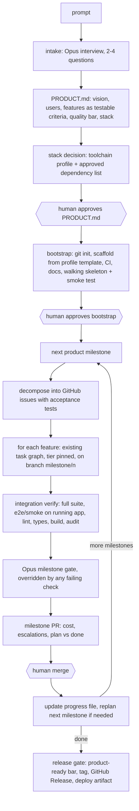

# Product Mode: from "add a test" to "build with it"

- **Status:** in progress. M6 Foundations done (PR #41, [ADR 0009](adr/0009-toolchain-profiles.md)); M7 Greenfield bootstrap done ([ADR 0010](adr/0010-product-graph-and-bootstrap.md), `scio new`); M8 next. Decision record: [ADR 0007](adr/0007-product-mode.md). Tracking: [milestones](https://github.com/NewMe505/SCIO/milestones), [project board](https://github.com/users/NewMe505/projects/1).
- **Date:** 2026-10-11 (plan), 2026-10-12 (M6, M7)

## Why
Today (M0–M5, v0.2.0) SCIO reliably takes **one task on one existing Python repository to one pull request**. Evidence: t001 passes 5 of 5 live trials at $0.13, and the nightly regression suite has pass^3 = 1.00 (see [EVAL_HISTORY.md](EVAL_HISTORY.md)). Product Mode extends this so a **prompt becomes product-ready software, in any stack**. A human approves each product milestone, and there is no dollar ceiling for the product as a whole.

## Gaps in the current code
| Gap | Where |
|---|---|
| `prepare_repo` only clones an existing repository that has a `main` branch. There is no greenfield (`git init`) path. | `scio/graph/nodes/prepare.py` |
| One run gives one PR. There is no product spec, no milestones, no issue breakdown, and nothing remembered between runs. The "initializer + progress file" pattern ([RESEARCH.md](RESEARCH.md)) is not built. | `scio/graph/nodes/worker.py`, `checkpoint_gate.py` |
| All checks assume Python: pytest selectors, ruff lint, traceback-based error signatures, `tests/` path rules, Python cache excludes. | `verify.py`, `aci/tools.py`, `state/signatures.py`, `loop/escalation.py`, `context/projections.py`, `prepare.py` |
| No way to install dependencies: the network is off, `PIP_NO_INDEX=1`, and editing a dependency file escalates. | `aci/sandbox/base.py`, `aci/sandbox/local.py`, `loop/impact.py` |
| The agent cannot delete files or run a server for smoke or end-to-end tests. | `aci/tools.py`, `aci/toolbox.py` |
| `SCIO_SANDBOX_BACKEND` is never read (I-054). | `scio/settings.py`, `scio/graph/run_context.py` |
| `scio run --tier` changes the budget but not the route (I-053). | `scio/cli.py`, `scio/graph/run_context.py` |
| The non-goal "No UI" and assumption F-8 ("target repos are Python") conflict with building products. | `docs/PROMPT.md`, `docs/ARCHITECTURE.md` |

## Design: a Product layer on top of the proven task graph
The task graph is unchanged. It remains the unit that builds one feature. A new Product orchestrator sits above it. It plans the product, bootstraps the repository, runs feature tasks one at a time (still a single writer), and stops for a human at each milestone.

Creating a GitHub repository publishes it, so a human always confirms that step.

### Components
1. **Toolchain profiles** (`scio/toolchain/`, `configs/profiles/*.yaml`). A `Toolchain` protocol covers:
   - setup and install
   - tests: selector semantics and the "no tests collected" code
   - lint, typecheck, format and build
   - run/smoke: start the app, wait for its health check, stop it
   - dependency audit
   - an error-signature parser
   - test-path patterns, cache excludes and the list of dependency files

   The current Python behaviour moves into a `python` profile with no change in behaviour. The regression suite proves that. Next comes a `node-ts` profile (npm/pnpm, vitest, eslint, tsc, Playwright). Each further stack is data plus a small parser. Existing repositories get their profile by detection.
2. **Product memory**, kept in the target repository:
   - `PRODUCT.md`
   - `.scio/product/progress.json` (milestones → features → status, commit, PR)
   - `docs/adr/`
   - `NOTES.md`

   Each feature run's context projection reads a compact summary of these files. This gives the `compactor` role its first consumer. A ranked repo map replaces the 120-file tree cap.
3. **Product orchestrator** (`scio/product/`). It is a LangGraph graph that calls the task graph as a subgraph. Each feature gets its own checkpoint thread, and the product state is checkpointed too, so a build can resume across sessions. CLI: `scio new --prompt "<idea>" --dir <path> [--gh owner/name]`, `scio build --product <dir>`, `scio status`.
4. **Sandbox and runtime.**
   - `SCIO_SANDBOX_BACKEND` is wired up, and Docker is the default for product builds.
   - Installation runs in two phases. During **install**, the network is limited to the profile's registry allowlist, a lockfile is written, and only dependencies on the approved list are allowed. During **test**, the network is off.
   - New tools: `delete_file`, `install_deps` (anything not on the approved list escalates), and `run_app` (manages the app's lifecycle and health probe).
   - There is still no free-form shell. Every command comes from the profile.
5. **Product-ready quality bar.** The milestone and release gates check all of these:
   - tests green, with a coverage floor
   - lint and types clean
   - the build succeeds
   - smoke and e2e tests pass against the running app
   - dependency audit and secret scan are clean
   - the README's run instructions work (CI runs them)
   - CHANGELOG, LICENSE and a Dockerfile or release artifact are present

   Any failing check overrides the model's verdict, as it does today.
6. **Budget.** By default the product has no dollar cap (`product.max_usd: null`, configurable). The per-feature tier caps, stall caps and iteration caps stay in place as runaway guards. Spend is reported in every milestone PR and at every human approval stop.

## Milestones
Each milestone has its own issue, branch and draft PR. Read [LESSONS_LEARNED.md](LESSONS_LEARNED.md) before starting each one.

| M | Deliverable | Done when |
|---|---|---|
| M6 Foundations | Fix I-053 and I-054 (with sweep and guard tests). Extract the `python` profile with no behaviour change. ADR 0009 (toolchain profiles). Update the PROMPT.md non-goals and F-8. | Regression pass^5 = 1.00 offline; live t001 still passes; no Python-specific command outside the `python` profile |
| M7 Greenfield bootstrap | `scio new`: interview → normalised PRODUCT.md → stack and profile → scaffold → git init → CI → walking skeleton. | On both Fake and one live run, an empty directory becomes a repository with green local CI and a passing smoke test |
| M8 Decompose + milestone loop | Progress file, GitHub milestones and issues, features run in sequence on the milestone branch, integration verify, milestone PR, merge_wait, resume. | A two-milestone Fake product survives a crash and resume with no duplicated issues or commits; one live milestone |
| M9 Dependencies + runtime | Docker default, two-phase network, `install_deps` / `run_app` / `delete_file`, e2e acceptance runner. | A product that needs a third-party dependency and an HTTP server passes black-box e2e tests |
| M10 Second stack | `node-ts` profile, profile detection, black-box acceptance grading that works for any stack. | The same product spec builds in Python and in TypeScript |
| M11 Product-ready + evals | Quality-bar checks, release gate, tag and artifact. Product eval suite: p001 CLI app, p002 REST API, p003 web app with UI, all graded by hidden black-box tests. | p001–p003 pass live; rows in EVAL_HISTORY; retrospective written |

## How earlier lessons shape this plan
- **Every structured output that drives control flow gets a normaliser, and the plan owns the step** (I-039, I-046). PRODUCT.md, the milestone plan and the stack decision are each normalised. The orchestrator, not the model, picks the next feature.
- **A hint is not a pin** (I-050). The orchestrator pins each feature run's tier.
- **The passing path needs a cap too** (I-046). Milestone loops have iteration and stall exits.
- **The Fake provider only reproduces the response shapes you thought of** (I-031 to I-035). Each milestone ends with one live trial (`keep_dirs`, cost by role) before anything is scaled.
- **Cost grows with the transcript** (I-038, I-040). Feature contexts stay small and cached, and product memory reaches them only as a summary.
- **Docker is not installed on the dev machine** (I-016). M9 needs it locally, or must run its live checks in CI.

## Verification
- **Every milestone:** the full local CI command from `CLAUDE.md` passes, the regression suite still has pass^5 = 1.00 on the Fake provider, and the milestone's new Fake end-to-end test passes.
- **End to end (M11):** `scio new --prompt "a CLI todo app with tags and JSON export"` produces a released repository whose hidden acceptance tests pass, and the same holds for the REST API and web-app prompts. Cost per feature and the number of human interventions are recorded for each.
