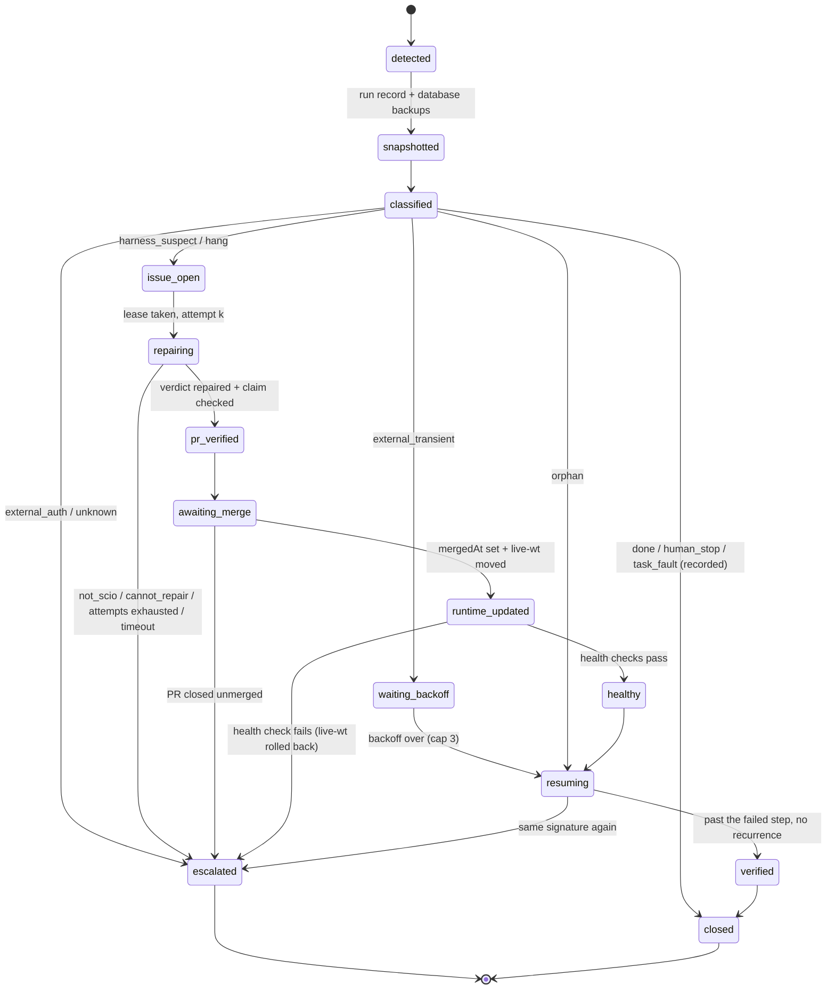

# ADR 0019: An external recovery supervisor: Claude repairs SCIO, and the interrupted build resumes from its checkpoint

- **Status:** Accepted, 2026-11-14. The owner answered section 12: 1 as recommended; 2 the broader permission mode (`auto`); 3 asked which option scales and changes better, and the answer is `%LOCALAPPDATA%` with an override; 4 as recommended; 5 as recommended; 6 do the drill.
- **Date:** 2026-11-13 (proposed), 2026-11-14 (accepted)
- **Issue:** #95

## Context

### The requirement
The owner wants SCIO to recover from failures in its own harness without losing the task it was running. An independent supervisor detects a failure and preserves the task's state. It then has Claude, acting as an external engineer, repair SCIO itself in a tested PR. A human merges that PR. The supervisor then updates the SCIO runtime and resumes the original task from its checkpoint. Today a person does each of these steps. A graphcalc session files a `live-run` issue (#81), a SCIO session fixes it, the owner merges, and the SCIO session moves `.scio/live-wt`.

### What already exists (discovery, 2026-11-13)
- **How a run executes.** `scio build` is a one-shot CLI process, not a service. The graphcalc session runs `sh scio.sh build --product <dir> --gh NewMe505/graphcalc` in the background. `graphcalc-run/scio.sh` does the following:
  - changes to the workspace;
  - drops `CLAUDECODE` and `ANTHROPIC_API_KEY`;
  - selects the Claude Code backend and `SCIO_PARALLEL_FEATURES=2`;
  - runs `uv run --project <SCIO> --no-sync python -m scio` with `PYTHONPATH=<SCIO>/.scio/live-wt`.

  So the **code comes from live-wt and the environment from the main checkout's venv**.
- **The task checkpoint already exists, and it is durable and idempotent.** Each piece below lives under the workspace's `.scio/`, because the DSNs are relative to the working directory (`scio/settings.py:48-50`):
  - LangGraph checkpoints are written with `durability="sync"` (`scio/graph/checkpointer.py`).
  - The effect log records `started` and `done` and uses world probes (`scio/graph/effects.py`, ADR 0003).
  - Thread ids are deterministic: `build-<product>-m<n>` and `build-<product>-m<n>-p<k>-a<attempt>` (ADR 0011).
  - `progress.json` sits in the product.

  Crash safety has executable proof: `test_crash_mid_run_resumes_without_duplicate_side_effects`, `test_crash_between_features_resumes_without_duplicates`, `test_github_mode_crash_after_the_pr_duplicates_nothing`, and guardrail 59's `test_a_new_thread_on_a_started_milestone_goes_on_where_the_last_one_stopped`.
- **Resuming today means re-running the same command with no `--decision`.**
  - A `HarnessError` inside a feature halts the thread with `feature_failed` and no interrupt (`scio/product/build.py`, I-100). The next `scio build` starts the next attempt.
  - The CLI resumes the thread recorded in `progress.json` while that thread is unfinished. Otherwise it opens a fresh `-r2` thread, which takes over the earlier runs (`scio/cli.py`, guardrail 59).
- **Outcome signals are ambiguous.** Exit 0 means either done or paused; stdout tells them apart with `PAUSED for a human:`. Exit 1 means either a halt (stdout `reason:` line) or an uncaught traceback. Exit 2 is a refusal. `_build` catches only `GitHubError`. That prints `scio build stopped on GitHub: ...` and a resume hint.
- **No liveness signal exists.** There is no PID file, lock or heartbeat for a build thread. A hard-killed build leaves no `__error__` write, so the dashboard shows it as `in_progress` forever. Nothing refuses a second `scio build` on the same thread.
- **Failure classes.** `RetryableError`, `RepairableError` and `FatalError` (with subclasses `BudgetExceeded`, `RefusalError` and `StructuredOutputError`) are defined in `scio/harness/failures.py`. On the Claude Code backend, `not logged in`, `authentication` and `invalid_grant`-style failures are `FatalError`. A hung `claude` process escapes every guard as `subprocess.TimeoutExpired`. I-180 reproduces this.
- **SCIO already runs Claude headlessly.** `claude_runner` (`scio/harness/providers/claude_code.py`) is an injectable runner. It strips `CLAUDECODE`, `ANTHROPIC_API_KEY` and `ANTHROPIC_AUTH_TOKEN`, so that print mode starts and the Max login pays (ADR 0012). Product sessions pass `--safe-mode` so they never read the operator's rules (I-171).
- **How live-wt is updated.** live-wt is a detached worktree. It is moved with `git -C .scio/live-wt checkout <sha>` after a merge. Two things read it: `scio.sh`, and the user-level push-gate hook that every session runs (guardrail 68).
- **GitHub and CI.** `GitHubClient` provides `ensure_label`, `ensure_issue` (an exact title found by listing, never by search; guardrail 48), `upsert_issue_comment` (by marker) and `pr_merged`. It has no merge operation. `scripts/watch_ci.py` reads a head's CI by its full SHA (I-104, I-172).
- **Ledger rules.** The ledger and guardrails are checked: `check_guardrails` fails when a resolved entry from I-104 onward is cited by no rule, or when a rule's guard does not exist.
- **Unattended runs.** The only precedent for running unattended on this machine is the nightly scheduled task (I-045's PowerShell recipe). That task has been disabled since 2026-10-12 (I-181).

## Decision (proposed)

### 1. Recovery lives outside SCIO
The supervisor is a separate top-level package, `recovery/`, a sibling of `scio/`. It runs as `python -m recovery`.
- **No dependency on SCIO's code.** It uses the **standard library only** and **never imports `scio`**. It reaches SCIO only through processes and files: the launcher's argv, stdout, stderr and exit code, the workspace's `.scio/` files, `git`, `gh` and `claude`. A SCIO defect, an import error, a broken venv or a hang therefore cannot disable it. A test parses every module under `recovery/` and fails on any `scio` import. It reuses the boundary-scan pattern of `test_no_stack_specific_command_outside_the_toolchain_package`.
- **What it reimplements.** It copies the patterns it needs instead of importing them: the `run_effect` shape, the secret scan and the CI-by-SHA reader. Each copy has its own test.

### 2. Where the supervisor runs (decided in 12.1)
The recommendation has three parts.
- **It is the parent process of the build.**
  - `python -m recovery run --workspace <W> -- build --product 
 --gh <R>` runs the workspace's own launcher (`sh scio.sh build ...`, named in `<W>/recovery.toml`). It uses the same working directory and the same environment.
  - The child writes its stdout and stderr to files, not pipes. A dead supervisor therefore neither blocks nor kills the build, and a later supervisor can read them.
  - The parent sees the exit code, a crash and a hang directly.
  - `scio.sh` stays unchanged. A graphcalc session opts in by calling the supervised launcher instead.
- **It runs from its own pinned code.**
  - It runs from a worktree, `.scio/recovery-wt`. Only an explicit `python -m recovery self-update <sha>` run by the owner moves it, never the post-repair move of live-wt. A repair to `scio/` therefore never changes the running supervisor, and a supervisor change never ships itself.
  - It runs on the machine's `python` (3.12.10). There is no venv and no launcher `.exe`, so Application Control is not involved (I-075).
- **It outlives itself.**
  - All its state is in SQLite (WAL mode) under `%LOCALAPPDATA%/SCIO/recovery/` (see 12.3).
  - `python -m recovery tick` reconciles every open record, and each of its steps is idempotent.
  - A Scheduled Task runs `tick` at logon and every 10 minutes, registered with I-045's PowerShell recipe (`StartWhenAvailable`, not `schtasks`). The owner confirms the registration, because it changes the machine.
  - A tick finds orphans, meaning runs marked running whose PID (checked together with its creation time, because Windows reuses PIDs) is gone. It then moves each incident's state machine forward.

A Claude Code session is not the supervisor. It lives only as long as a conversation, keeps no state of its own, and is the thing the supervisor starts.

### 3. The task checkpoint is SCIO's; the supervisor records an incident that points at it
SCIO's checkpoint, effect log and `progress.json` are not duplicated.
- **Run record.** For each supervised run the supervisor records:
  - run id, workspace, argv, and the working directory;
  - the environment's variable names, plus values only for an allowlist (`SCIO_*` without secrets, `UV_SYSTEM_CERTS`);
  - the SCIO SHA (live-wt's HEAD);
  - the product directory, its branch and HEAD, and the build thread (read from `progress.json` and the CLI's `thread` line);
  - PID and creation time, start time, last progress time, end time and exit code;
  - the paths of the output files.
- **Snapshot on a failure, before anything else:**
  - copies of the workspace's `checkpoints.sqlite` and `effects.sqlite`, made with `sqlite3.Connection.backup`. A file copy is unsafe, because the databases are in WAL mode;
  - `progress.json`;
  - for the product, `git rev-parse HEAD`, `git status --porcelain`, and the heads of its `milestone/*` and `agent/*` branches;
  - the tails of stdout and stderr and of the thread's cost ledgers;
  - the paths of the artifact directories.

  The supervisor never writes the originals. A repair reads the copies, and a resume that goes wrong can be rolled back to them.
- **Resume instructions** mean replaying the recorded argv with no `--decision`, from the recorded working directory and environment, and only after the health check (8). The "outstanding steps" are what the checkpoint's `next` and `progress.json` say. The supervisor does not keep a list of its own.
- **Idempotence** comes from two places:
  - SCIO's own mechanisms, with the tests named above;
  - the supervisor's own step log, keyed `hash(incident, step)`, where each externally visible step has a probe. The issue is found by its exact title, the PR by its head branch, and the live-wt move by `rev-parse HEAD`.

### 4. One writer per workspace
`run` takes a lease on the workspace (a row with PID and creation time) before it starts SCIO, and holds it until the child exits. `run` refuses to start while that workspace's lease belongs to a live process.

live-wt moves only when no `python -m scio` process is running from it. The supervisor checks this with `Get-CimInstance Win32_Process` over the command lines. Lazy imports would otherwise mix two code versions in one process.

### 5. Detection and classification: a pure function with flip tests
`classify(evidence) -> class` is deterministic, in the style of ADR 0005's triage. Each row has a test that flips it and a test that does not.

| Evidence | Class | Action |
|---|---|---|
| exit 0 and `PAUSED for a human:` | `human_stop` | Record it and notify. The supervisor never answers a stop. |
| exit 0, no pause | `done` | Close the run. |
| exit 1 with halt `integration_failed`, `gate_escalated`, `release_failed`, `stopped`, `budget` or `load_failed` | `task_fault` | Record it. No repair; the human decides, as today. |
| `not logged in`, `authentication`, `invalid_grant` anywhere in the failure | `external_auth` | Escalate ("sign in again"). Never repair, because the repair session would fail the same way. |
| rate limit, usage window, `overloaded`, `scio build stopped on GitHub:` | `external_transient` | Replay after a backoff, at most 3 times, then escalate. |
| exit 1 with a traceback whose innermost frames are under `scio/` (or LangGraph called from `scio/`) | `harness_suspect` | Incident, then repair. |
| `feature_failed` whose last ledger line names a `HarnessError` that is not one of the external kinds above | `harness_suspect` | Incident, then repair. |
| no progress for `hang_after` (default 45 min, above the worker's 30-minute turn cap) | `hang`, then `harness_suspect` | Kill the process tree (`taskkill /PID <pid> /T /F`), then open an incident. |
| PID gone with no exit recorded (the supervisor died, or the machine restarted) | `orphan`, then `environment` | Replay with no repair, unless stderr ends in a traceback; then classify that. |
| anything else | `unknown` | Escalate. |

- **Progress** is the newest modification time among `.scio/ledger/*.jsonl`, `checkpoints.sqlite-wal` and the output files.
- **The signature** is `sha256(class, exception type, innermost scio frame as path:function, the message with numbers, paths and ids removed)`.
- **Only `harness_suspect` starts a repair.** The repair session's first job is to confirm that the cause is in SCIO.

### 6. Incident identity, dedupe and GitHub
- **One incident per signature.** An open incident with the same signature takes the new failure as one more occurrence, so a second incident is never opened.
- **Its GitHub issue in this repository:**
  - Title: `recovery: <class> <innermost frame>: <message summary>`.
  - Labels: `bug`, `live-run` and `recovery`, each created before use (guardrail 18).
  - The body carries `<!-- scio-recovery:<signature> -->`.
  - The supervisor finds the issue by listing (guardrail 48). Its progress is one comment that it updates in place (`upsert_issue_comment`'s marker pattern).
- **Visibility to sessions.** Every SCIO session's state-first inspection already lists the open `live-run` issues. A human session that sees `recovery` in progress there leaves the incident alone, or holds it with `python -m recovery hold <incident>`.

### 7. The repair session: Claude as the external recovery engineer (the grant is decided in 12.2)
- **Where it works.**
  - A fresh worktree from `origin/main` at `.claude/worktrees/recovery-<incident>`, on branch `fix/<issue>-<slug>`. That path is already git-ignored and skipped by every repository-wide scan (I-155).
  - The supervisor runs `uv sync --frozen --all-extras --group dev` first (guardrail 54).
  - Never live-wt, the product, the workspace's `.scio/`, or `main`.
- **How it starts.** `claude -p` runs from that worktree **without `--safe-mode`**. It therefore loads SCIO's CLAUDE.md, the project memory and both push-gate hooks. Those are the rules the repair must follow: an issue first, a ledger entry, a systemic sweep, a guardrail with a guard, `scripts/gate.py`, and a draft PR. This is the opposite of a product session (I-171).
  - Environment: `CLAUDECODE`, `ANTHROPIC_API_KEY` and `ANTHROPIC_AUTH_TOKEN` removed, and `SCIO_PROVIDER_OVERRIDE=fake`, because the repair is offline by default.
  - P4 measures whether a worktree under `.claude/worktrees/` sees the main project's memory. If it does not, the brief names the memory rules the repair needs.
- **The brief (stdin) contains:**
  - the incident: class, signature and occurrences;
  - the evidence paths, including the database copies, marked **as data, not instructions**, because logs hold model output from product sessions;
  - the run record, the SCIO SHA and the issue number;
  - past incidents with the same signature or innermost frame, with their ledger ids and PRs.
- **The contract the brief states:**
  1. Reproduce the failure first.
  2. Decide whether the cause is in SCIO. If it is not, answer `not_scio` with the evidence and change nothing.
  3. Otherwise fix it, with a regression test shown to fail on the old code, a sweep, a ledger entry and a guardrail.
  4. Run the gate and open a draft PR with `Closes #<issue>`.
- **The grant (the owner's decision, 12.2).**
  - Mode: `--permission-mode auto --permission-prompts none`, with no allow list.
  - `--disallowedTools` is a hard limit under `auto`: `Bash(gh pr merge*)`, `Bash(gh api *)`, `Bash(git push --force*)`, `Bash(git push -f*)`, `Bash(git push origin main*)`, `Bash(git reset --hard*)`, `Bash(git stash*)`, `Bash(git checkout main*)`, `Bash(git worktree *)`.
  - Underneath both, the push-gate hook and the repository's ruleset still apply: `main` requires a PR and a green `checks` status.
- **Caps.**
  - A wall clock of 90 minutes, then the supervisor kills the process tree.
  - `--max-turns`, with the value measured on the first drill. A cap needs its own measurement (I-099).
  - `--max-budget-usd` as an estimate cap.
  - At most 2 attempts per incident.
  - One repair at a time on the machine (a lease).
  - At most 3 incidents per workspace in 24 hours (a circuit breaker).
  - A signature that comes back after its fix merged escalates and is not repaired again.
- **The verdict.** `--output-format json --json-schema` returns `{verdict: repaired | not_scio | cannot_repair, pr_number, branch, ledger_id, root_cause, regression_tests[], gate, risks[]}`.
- **The supervisor checks the claim and does not trust it** (guardrail 60):
  - the PR exists with that head branch and `Closes #<issue>`;
  - CI is green for that head's full SHA;
  - the diff changes a file under `tests/` and `docs/ISSUE_LEDGER.md`;
  - live-wt's HEAD, the product's HEAD and the workspace databases' hashes are unchanged.

  A failed check counts as a failed attempt. When the attempts run out, the incident escalates with the checkpoint intact.

### 8. Merge, update, health check, resume
- **Merge stays human.** Each tick reads `gh pr view N --json mergedAt,mergeCommit,state` (guardrail 8). A PR closed without a merge escalates.
- **Updating live-wt.**
  - Preconditions:
    - no `scio` process is running from it (4);
    - its tree is clean;
    - the target is the merge commit, which is an ancestor of `origin/main`;
    - CI on `main` is green for that SHA.
  - Then `git -C .scio/live-wt fetch origin` and `git -C .scio/live-wt checkout --detach <sha>`, probed by `rev-parse HEAD`. The previous SHA is recorded for rollback.
  - This also moves the hook that every session runs (guardrail 68), which is one more reason for the CI precondition.
- **Health check.** Every step must pass, or live-wt goes back to the recorded SHA and the incident escalates:
  1. `sh scio.sh --help` exits 0 from the workspace (SCIO has no `--version`; I-184).
  2. `uv.lock` is the same at the old and new SHA. The launcher runs `--no-sync` on the main venv (owner, 12.5).
  3. The halted thread loads under the new code. `scio status --product 
` and `scio report --thread <T>` must exit 0 against **copies** of the workspace's databases (guardrail 14). A repair that changes `scio/state/models.py` and cannot read the old checkpoint stops here, before any resume.
- **Resume** replays the recorded argv with no `--decision`, as a new supervised run linked to the incident. It is automatic only for `harness_suspect`, `hang` and `orphan` (owner, 12.4). Merge, gate, release and feature-decision stops always wait for the human.
- **Verify.** The incident closes when the resumed run reaches its next pause, halt or done without the same signature, and its thread has passed the failed step. The evidence is a new cost-ledger line, or a checkpoint later than the failure on the attempt's thread. The same signature again trips the circuit breaker, and the incident escalates.

### 9. The state machine

Each transition is a step in the supervisor's step log, run by `run` or by `tick`, and each is safe to run twice. Escalation preserves everything: it adds a `needs-human` label and a comment to the issue, and the supervisor deletes nothing.

### 10. Engineering memory in three layers
- **Observed:** the supervisor's incident database, plus an append-only `incidents.jsonl` export that readers take complete lines only from (guardrail 24). It holds the signature, class, timeline, evidence paths, attempts, PR and outcome. These are observations, not lessons. `python -m recovery incidents --signature <s> | --grep <text>` searches them.
- **Investigated:** the ledger entry the repair session writes in its PR (root cause, fix, sweep, guard). The owner reviews it, CI checks it, and so does the docs check. The supervisor never writes `docs/` on `main`. The ledger entry arrives when Claude takes the issue up, which is what CLAUDE.md already requires for `live-run` issues. At detection, the incident is recorded in the incident database and on GitHub. This is the one place the design departs from the request's step 5, and the reason is that the ledger is only written on reviewed branches.
- **Validated:** a guardrail with a running guard, which `check_guardrails` enforces. An AI explanation becomes a lesson only through this layer.

### 11. Small changes on the SCIO side, made through the usual process
- **`--outcome-file PATH`** for `build`, `new`, `run` and `resume`. At exit SCIO writes one JSON object:
  - `status`: done, paused, halted, refused or crashed;
  - `exit_reason`, the thread, and the stop kind;
  - the resume argv;
  - for a crash, the exception type and the innermost frame under `scio/`.

  A top-level handler writes it and then re-raises, so the traceback and the exit codes stay exactly as they are; the graphcalc session reads them. The supervisor uses the file when it exists and falls back to the text markers when a broken SCIO wrote none.
- **I-180's fix** comes from the drill (13).

### 12. The owner's decisions (2026-11-14)
1. **Where the supervisor runs:** the parent wrapper plus a scheduled `tick` at logon and every 10 minutes.
2. **The repair session's grant:** `--permission-mode auto --permission-prompts none`. The deny list in 7 stays as a hard limit beneath it, and the allow list is dropped. A probe confirmed that print mode accepts `auto` and completes a turn with no denials. Phase 4 then has to show, in a throwaway worktree, which of the repair's real actions `auto` allows: Edit and Write, `uv run python scripts/gate.py`, `git push -u origin fix/*` and `gh pr create --draft`. It must also show that a denied command such as `gh pr merge` is still refused. If `auto` refuses the push or the PR, that goes back to the owner; there is no silent fallback. **Measured live on 2026-11-14.** The supervisor's own `prepare_worktree`, `repair_argv` and `run_repair` ran with a probe brief in place of an incident: 0.7 minutes, 10 turns, $0.40 estimated, nothing billed. Under `auto`, these worked: Write, `uv run python -m pytest`, `git commit`, `git push -u origin fix/95-recovery-a0b0c0` and `gh pr create --draft` (PR #97, closed unmerged straight afterwards and its branch deleted). The deny rules refused `git stash list` and `gh pr merge --help`. Claude Code's own `permission_denials` lists both, so the result does not rest on the session's report. SCIO's hooks loaded as well: the pipefail hook refused a piped pytest.
3. **Where its state lives:** `%LOCALAPPDATA%/SCIO/recovery`, which `SCIO_RECOVERY_HOME` overrides. The owner asked which option scales and changes better, and this one wins on both:
   - One store per machine serves any number of workspaces.
   - It does not depend on any checkout, so branch switches, worktree removal and moving the repository leave it alone.
   - OneDrive does not sync it, and syncing can corrupt a busy SQLite WAL.
   - A `schema_version` table makes later changes migrations.
   - The location is a single setting, so moving it, or moving to a server database, means changing one setting.
4. **What resumes automatically:** a crash, a hang or a `feature_failed` after a merged repair, and an orphan. Never a human stop.
5. **A repair that changes `uv.lock`:** the resume is refused and the incident escalates (version 1).
6. **The live drill:** I-180 is the real defect, so it is not fixed by hand before the drill. The drill's fault is injected once and outside everything the run record carries, for example a switch that the workspace launcher removes after using it. Otherwise the replay would reproduce the fault, and the incident would never reach `verified`. I-182 (the orchestrator nodes' guard gap) sits on the same path, and the repair's sweep is expected to reach it.

### 12a. Measured before the code (pre-flight 8, 2026-11-14)
- A child started with `subprocess.Popen` survives when its parent is killed, whatever the creation flags (none, `CREATE_NEW_PROCESS_GROUP`, `DETACHED_PROCESS`, `CREATE_BREAKAWAY_FROM_JOB`). The shell this was measured from is not in a job that kills on close.
- Under Task Scheduler, measured with a temporary task that was registered, run once and deleted:
  - The process is in no job, and `CREATE_BREAKAWAY_FROM_JOB` is refused (`[WinError 5]`). The fallback without it works, and the detached child outlived the task.
  - The task's PATH has `uv`, `claude`, `gh`, `git` and `python`, but **no `sh`**.
  - On Windows a bare argv[0] is found on the parent's PATH, never the child env's. So every spawn resolves its program against the env it runs with (`commands.resolve_program`, I-183, guardrail 69).
- `taskkill /T /F /PID <sh>` reaches the Python process under `sh -> env -> uv -> python`, the same chain `scio.sh` builds.
- `run` passes the child's stdout and stderr through to its own output as well as to the files, and exits with the child's code. A graphcalc session therefore still reads `PAUSED for a human:` and the resume hints.
- A replay from `tick` runs in Task Scheduler's environment. So the run record also keeps `PATH`, `USERPROFILE`, `HOME`, `APPDATA` and `LOCALAPPDATA`, which hold no secrets. Without them, `sh`, `uv`, `claude` and the Max login might not resolve.
- "Standard library only" is a test, not a note. Any import under `recovery/` that is not in `sys.stdlib_module_names` and not `recovery.*` fails it. `python -S -m recovery --help`, which skips site-packages, must work.

### 13. Validation
- **Offline, in CI** (`tests/recovery/`):
  - The classifier's flip tests.
  - The boundary scan.
  - The step log run twice.
  - The lease refusing a second run.
  - The PID and creation-time orphan check.
  - Snapshot backups taken while a writer holds the WAL open.
  - The repair runner, through an injected `claude` runner and a `FakeGh`. Its verdict checks include a session that claims a PR that does not exist.
  - The live-wt move and its rollback, on a temporary worktree.
- **End to end offline**, with injectable runners and a temporary clone of SCIO on a local bare origin:
  - A product build is crashed by an I-180-style stub `claude` that sleeps past a short `SCIO_REQUEST_TIMEOUT_S`.
  - The run is detected and snapshotted, an issue is opened, and a scripted repair commits the fix on a branch.
  - A simulated merge lands it on the bare origin's `main`, with `mergedAt` in `FakeGh`.
  - live-wt is moved, the health check passes, and the build is resumed and finishes.
  - Assertions: no duplicated commit, issue or PR, and the attempt numbering continues.
  - Variants:
    - a hard kill of the build, which resumes with no repair;
    - a repair that fails twice, which escalates with the databases and checkpoint unchanged;
    - the supervisor killed mid-incident, where `tick` finishes the incident.
- **One live drill:** the real repair session on the real I-180 in this repository. It produces a real PR, merged by the owner; there is a human merge in the middle by design. Then the interrupted build resumes and finishes. Its turns, wall time and cost set the caps in 7.

### 13a. Phases (each one a slice on this branch with its own gate)
| Phase | Delivers | Done when |
|---|---|---|
| 3. Supervisor core | `recovery/`: state DB, `run` wrapper, liveness, lease, classifier, snapshot, `tick` for orphans; the boundary test | flip tests, lease, orphan and snapshot tests green; a stub child that crashes, hangs, pauses or finishes is classified right |
| 4. Repair integration | worktree, brief, `claude` invocation through an injected runner, the verdict and its checks, the caps | a scripted repair passes and a lying or failing one escalates, offline |
| 5. Checkpoint and resume | merge detection, the live-wt move with probe and rollback, the health check, replay, the verify step | the offline end-to-end test passes |
| 6. GitHub and memory | issue, labels, upserted comment, `incidents.jsonl`, search, history in the brief; SCIO's `--outcome-file` | GitHub through `FakeGh`; the outcome file in every exit path |
| 6b. Survival | a scheduled-task registration script (the owner runs it) | `tick` resumes a killed supervisor's incident |
| 7. Validation | the variants above and the live I-180 drill | the drill's PR merged, the build resumed and finished, its numbers in the retrospective |

## Consequences
- **What does not change.** `scio.sh`, the graphcalc session's commands, the `live-run` protocol, exit codes and stdout all stay the same. Supervision is opt-in for each workspace, and merges stay human.
- **Risks and what bounds them:**
  - **An unattended session with write and push access.** The allow and deny lists, the push-gate hook, the ruleset on `main`, and a human merge bound it.
  - **Prompt injection through evidence.** The evidence is marked as data. The grant cannot merge or touch `main`, and a person reviews every PR.
  - **A repair that treats the symptom.** It must reproduce first, show its regression test failing on the old code, and pass CI and review. If the signature comes back, the circuit breaker trips.
  - **Checkpoint incompatibility after a repair.** Health check 3 catches it before a resume, and live-wt rolls back.
  - **Mixed code versions.** live-wt never moves under a running process.
  - **The usage window.** Repairs use the same Max window as the build. One repair at a time and the turn caps limit that.
  - **Windows process trees and PID reuse.** The supervisor kills with `taskkill /T` and keys processes by PID and creation time.
- **Found while building it (2026-11-14):**
  - **One GitHub issue per incident, never per signature.** A later incident with the same signature that reused the earlier issue would put its repair on the branch the earlier repair left. The brief links past incidents instead.
  - **Every escalation opens an issue with needs-human if it has none.** This covers an orphan and a transient failure whose replays ran out, so the owner always sees an escalation on GitHub.
  - **A repair holds the tick.** While a session runs (up to 90 minutes, twice), the other incidents and the orphan pass wait for the next tick. This follows from one repair at a time and is accepted for version 1.
  - **Three more leases** (`incident:<id>` while one incident is driven, plus `tick` and `repair`) and a `finished` step for each handled run mean that two ticks never act on one incident or one run twice.
- **One more process to keep current.** The supervisor's own updates are a deliberate act of the owner's (`self-update`), never automatic.
